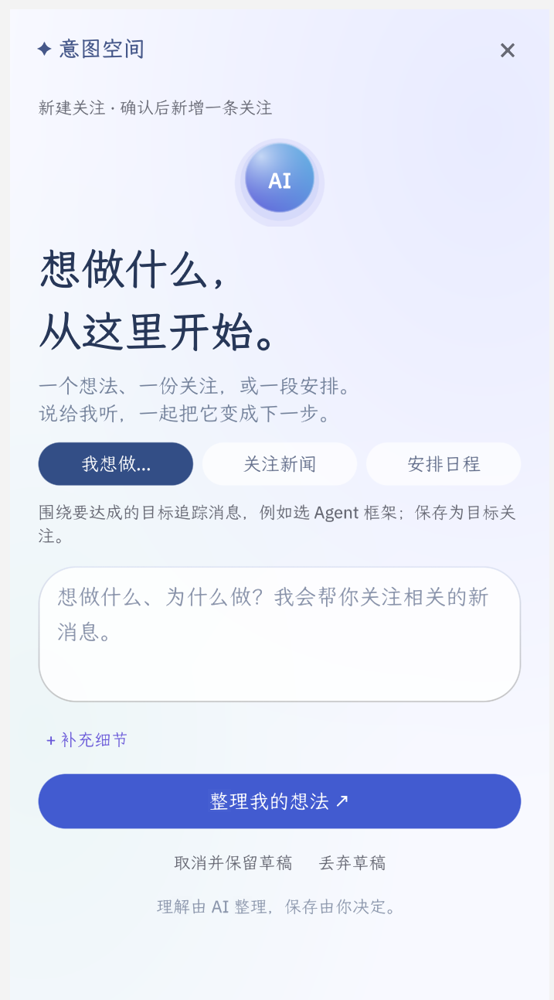
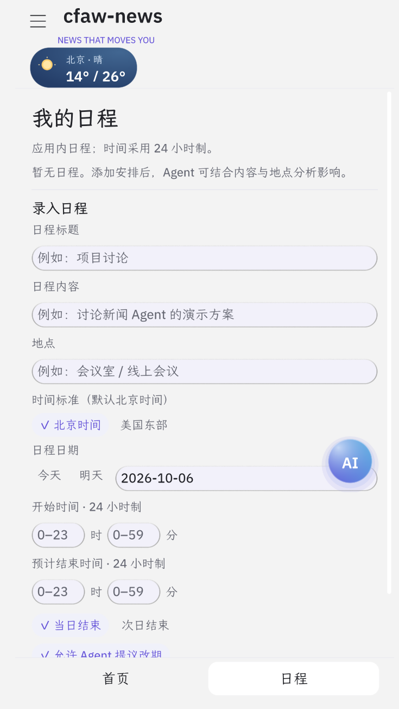
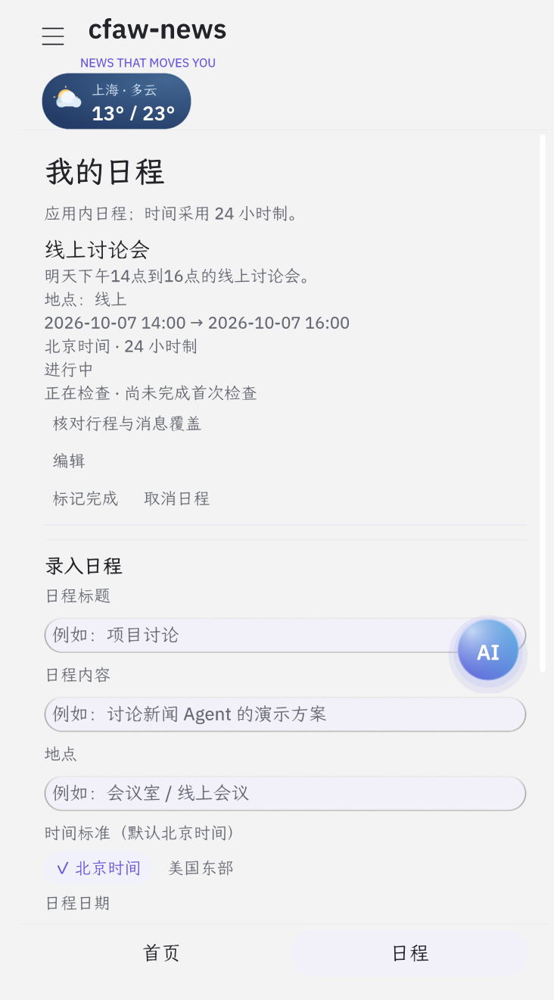
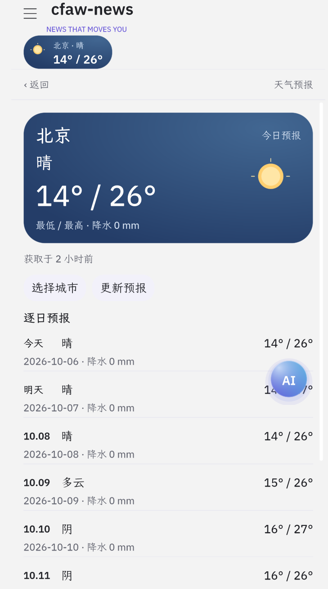
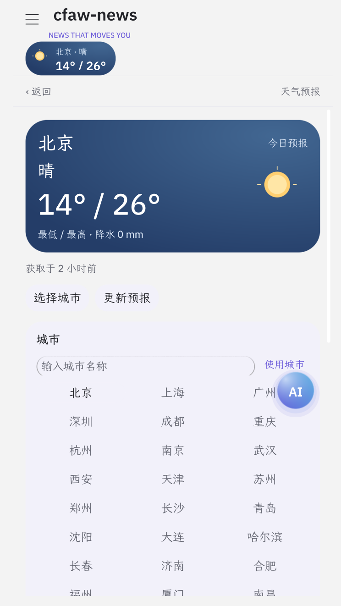
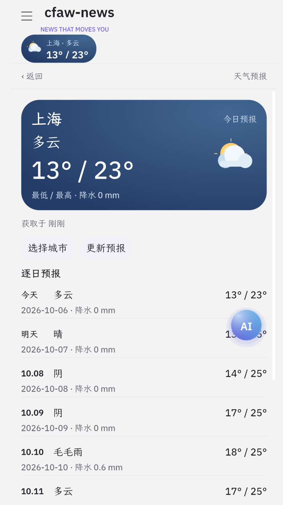
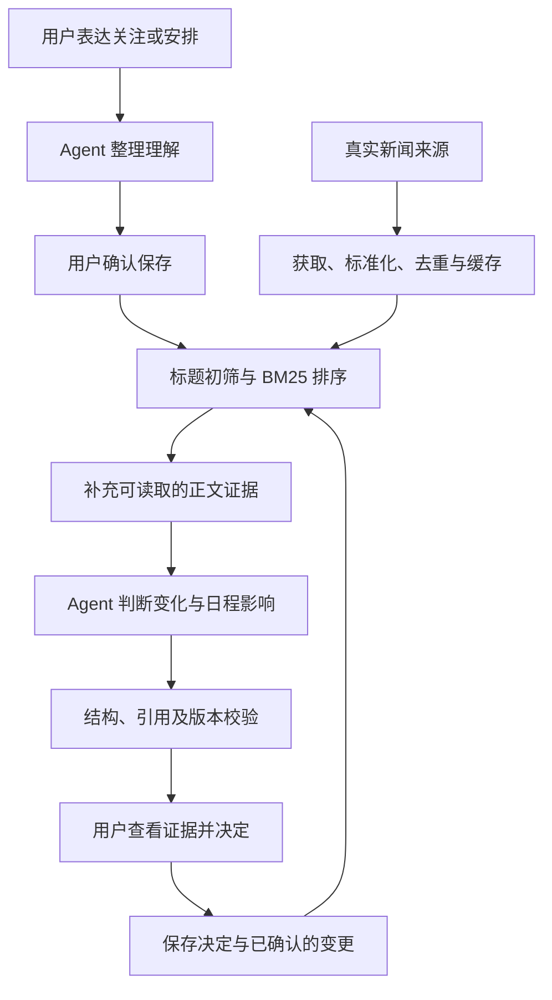

# CFAW News

**让 AI 新消息，与你的下一步有关。**

CFAW News 是一款运行于 **Rinx** 的新闻 Agent 应用，面向工作、学习与日常生活中的信息需求。用户用自然语言表达关注或安排，应用从真实来源获取新闻，筛选相关新闻，并由 Agent 判断变化与用户目标、日程的关系。用户可以阅读报道、核对证据，再决定观察、处理或忽略建议。

我们希望回答的不只是“今天发生了什么”，还有：**“这条新消息，是否改变我下一步应该做什么？”**

界面与业务采用 **OctoScript / Makepad**，助手通过 Rinx 管理的 Octos 服务运行，团队选择 **MiniMax** 作为模型提供方。

## 为什么做这个作品

AI 工具、研究和应用每天都在更新，但信息数量增加，并不意味着用户更容易找到有用的内容。

- **工作中**：想知道新的 AI 能力能否帮助整理资料、撰写内容或改善工作流程。
- **学习中**：想了解适合当前学习目标的新工具与进展，而不只是浏览技术名词。
- **生活中**：想持续关注感兴趣的领域，或判断新信息是否影响已有安排。

CFAW News 把用户目标、相关新闻、应用内日程和用户决定放在同一个流程里。它不会把“有关联”直接当成“应该行动”：证据不足时应说明未知项，没有实质变化时也可以不提出新建议。

## 核心体验

### 1. 用一句话表达关注

点击底部导航中央的圆形加号，进入全屏意图空间。可以持续关注一个话题，也可以围绕实际目标表达需求，例如：

> 我想了解最新 AI 进展如何帮助我的工作、学习和日常生活。

> 关注具身智能领域。

Agent 整理关注目的、范围与偏好，必要时提出关键追问。用户查看理解预览后确认保存；关注可以修改、暂停、恢复或取消。尚未确认的输入保留为草稿，不直接变成正式记录。模型返回格式不合约时自动纠正一次；仍失败时显示具体字段问题并保留输入，不能绕过校验保存。

“待确认的理解”提供 **编辑理解 → 应用修改 → 确认关注并保存**：可直接修改关注名称、目的、范围、偏好和检索关键词，并移除扩展来源或分类。范围、偏好与关键词按每行一项填写；改变关注对象时应同步调整关键词。应用修改只更新预览草稿，不再请求模型，也不创建正式关注；确认后保存用户修改后的全部字段。空名称、缺少范围或超限内容会显示具体提示并保留编辑，取消保留草稿后仍可继续，放弃本次修改则返回进入编辑时的理解。

空白意图面板提供三个可编辑的生活场景入口：**每周两小时学习 AI、是否换电脑、家人云相册的权益与隐私变化**。点击仅填入目标示例，不调用模型、不直接保存，也不会覆盖已有草稿。请按自己的情况修改；涉及具体产品的关注，应补充产品名称。

从表达想法到确认关注：输入“我想了解最新 AI 进展如何帮助我的工作、学习和日常生活”，Agent 将其整理为关注目标、具体范围与偏好，用户核对后再保存。

| 表达想法 | 核对 Agent 的理解 |
| --- | --- |
|  |  |

本文图片均为团队提供的应用运行截图，展示拍摄时的界面状态；新闻、天气及日程时间以当时的数据为准。

### 2. 阅读真实来源的新闻

首页提供搜索、分类筛选、图片热点卡片和普通新闻列表。新闻保留来源、原文地址、发布时间与获取时间；未知日期不会被填造。

阅读入口为 **全部、科技、商业、生活**，四个入口等宽平铺于整行，文字居中。科技涵盖AI、数码设备、效率工具与科学探索；商业涵盖企业、融资与产业变化；生活涵盖隐私、订阅、健康、环境与出行。优先依据每篇标题和来源摘要中的关键词分类，缺少线索时参考来源；允许交叉归类，如AI企业融资新闻可同时属于科技和商业。分类不调用模型，也不替代Agent的影响判断。筛选后显示当前条数与全部条数。

- 点击“刷新新闻”或在新闻区域上滑，主动更新启用的来源。
- 刷新过程中可以停止更新；右下角箭头返回顶部。
- “我的 → 新闻来源”可以调整来源，并查看各来源的获取状态。
- 与有效关注、日程有关的报道参与首页排序；规则匹配本身不会被当作 Agent 分析结论。

新闻来自配置中的真实来源。本地缓存支持再次阅读，获取失败时不会填充编造报道。

当前默认启用 **36氪、IT之家、少数派、MIT Research、Solidot、爱范儿、NASA 新闻发布、超能网、极客公园、Popular Science（环境与生活）**。原有其他来源保留在来源目录中，暂时关闭。升级时首次迁移旧来源选择，保留关注、收藏和日程；之后尊重用户在来源页的选择。已有配置的用户请在 **我的 → 新闻来源** 手动启用新增来源；不会自动覆盖自选配置或全部关闭的选择。The Conversation 提供可读 Atom 正文和署名，但当前宿主联网超时，作为默认关闭的可选来源保留。

关注更新按小步骤扫描新闻，每片最多512个Unicode字符，话题检查先根据标题初筛：具体话题优先匹配关注名称里的具体关键词，实用目标匹配其具体任务关键词；摘要、来源和分类不能单独让一条报道进入话题候选。通过后再补读来源摘要或正文，候选仍需 Agent 判断实际关联。标题未提及关键词的报道可能漏召回，可编辑关注关键词；日程及旧显式来源关注保留原召回路径。英文整词与中文二元词在一次扫描中计数，下一片先安排再执行，宿主中断一次后仍可续跑；按处理片段回收临时内存，避免连续长摘要触及宿主内存上限。页面显示已检查条数，本地 `tracking_preparation_v1.json` 只记录阶段、计数和耗时，不保存意图、新闻正文或提示词。召回与正文证据准备最多等待45秒，超时会显示阶段和检查进度；关注或日程变化会终止旧检查，取消后可重新检查。正文提取中断时仍保留超时回退，按真实来源摘要继续，不能把缺失正文当作已读证据。追踪分析采用下文的分阶段期限，非追踪请求仍按90秒总期限处理。

扫描完成后，证据快照、上次判断、用户决定和模型材料也按条目分步整理。模型投影只复制必要字段，超限时删除末尾整篇候选并记录遗漏，不反复复制完整历史与全部引文。续步在本地工作前安排，单次宿主中断后可重试；取消、目标或用户决定变化立即停止。准备阶段仍共用45秒期限，模型阶段另行计时；“已检查128/128条”只说明召回扫描完成，不表示材料已交给模型。执行边界与验证见 [快照准备修复](reports/tracking-snapshot-20261012.md)。

完整材料核对后在新执行片交给应用Agent；任务的总期限、连接期限和连接续步先建立，再刷新进度界面。相同任务的中途续步不会重复请求模型，尚未获得等待保护的部分启动会明确失败。

点击“关注话题”会用文章标题和原文地址创建可编辑草稿；用户调整对象与范围，整理后确认保存，才产生跨来源的话题关注。不会一键关注整个媒体；已有未完成草稿先恢复，避免被另一篇新闻覆盖。旧来源规则仍可在关注管理页删除。

Windows 宿主对单次脚本回调有时间限制；启动时分段读取收藏、关注、日程和分析记录，随后逐源恢复新闻缓存，避免已有记录使初始化中断。公开来源超时或限流会显示在“新闻来源”中，并计入已完成进度。

关注文档与追踪历史在启动时分别异步读取、解析和校验；每个话题、决定、分析结果独立占用一个回调，不把12轮历史放在同一片内核验。续步在工作前安排，恢复受每份文档15秒截止约束；失败保留主文件与备份并限制写入，显示具体警告后继续新闻初始化，不让分析历史恢复阻断首页。有效备份仍沿用只写备份的保护。关注记录与新闻缓存格式不变，完整启动回归见 [启动恢复验证](reports/startup-topics-20261012.md)。

全文 RSS 刷新逐条解析并回收临时内存，仅保留来源条数上限内的原文片段。每个来源的30秒期限覆盖请求、正文解析和缓存写入；任一来源未能完成时保留旧缓存并结束该来源的等待。首页已有分析标注将单轮核验与单条投影分开恢复，新闻列表不等待全部历史核验；标注仍检查当前目标、版本、正文和时效，用户操作保留严格校验。

当前 Windows 开发宿主需要包含字节压力回收保护的 Rinx：`scripts/patch_news_gc_host.py` 在固定 Makepad 的 32 MiB 沙箱接近上限时触发回收，保留硬上限；`scripts/build_news_refresh_host.ps1` 接收 `-HostRoot`、`-CargoHome`、`-Python`，生成 `rinx-news.exe`。完成构建后退出旧宿主，用新宿主重新 Review/Run 本项目的 bundle；应用记录格式与 app ID 沿用原值。此补丁与新闻解析/展示切片共同修复连续刷新中断，不能仅用固定页面样例替代真实 RSS 验证。

首页将搜索、分类、天气入口和主动刷新放在上方，下面展示图片热点与新闻列表。每条报道保留来源和发布时间，并提供关注话题、收藏与查看入口；底部导航中央的加号可随时进入意图空间。

<p align="center">
  
</p>

### 3. 看正文、配图与原文

受支持的网页可以提取正文段落、标题、列表、引用、部分图片和图注。阅读页采用两端对齐、宽松行距和段间留白，正文宽度限制在适合阅读的范围内。

阅读页分别展示标题、新闻摘要和正文。MIT、少数派、爱范儿、NASA 与 Popular Science 直接显示来源摘要；36氪、IT之家、Solidot、超能网与极客公园的 RSS 描述是正文，单独保存，不冒充摘要。正文优先读取 RSS 提供的文章内容，少数派读取公开文章的 SSR 正文段落（嵌入视频、配图可在应用内原文页查看）。Solidot 提供的是其自身短报道，不是所引用的外部报道全文。列表每页最多40条，底部提供翻页按钮；分页不会缩减 Agent 可检索的新闻集合。

没有来源摘要时，点击 **“Agent 摘要提取”** 才使用 Rinx 已配置的助手生成摘要。长文章按 Unicode 字符分段，全部分段处理后汇总；正文未读取成功或被截断时不生成全文摘要。支持取消和失败重试，切换新闻会取消当前摘要任务；生成结果在当前会话中保留。此功能与追踪共用应用 Agent 的调用边界，模型与密钥仍由宿主管理。

配图优先使用网页提供的阅读尺寸和懒加载地址，避免下载超大的印刷原图；保留每图 2 MB、合计 6 MB 的限制。单张失败会显示原因并提供“重试配图”，也可在应用内原文页查看。

“打开图文原文”使用应用内 `WebReader` 打开来源网页，不再调用 `LinkLabel/open_url`。返回按钮先关闭网页并回到新闻详情，再次返回新闻列表。原文地址仍可复制；结构化图文阅读仍保留。原站网页能否呈现取决于宿主的内嵌网页实现及网站访问条件，结构化阅读不执行原站脚本。

当来源限制正文读取时，应用保留可用摘要与原文入口，并说明无法读取的原因。没有摘要时也不会生成虚构摘要。

遇到 AWS / Cloudflare 人机验证响应时，新闻详情会自动进入应用内原文页，用户可在页面中完成验证后继续阅读。Windows 开发宿主通过 `native/windows-webreader` 提供 WebView2 实现，并在独立的 WebReader 会话目录中保留网站验证 Cookie；这不会让普通 HTTP 抓取器自动得到全文，也不会将未抓取的正文冒充 Agent 分析证据。

当前 Windows 合并版使用同时包含 WebReader 与新闻内存回收修复的 `rinx-news.exe`。从项目根目录运行 `powershell -ExecutionPolicy Bypass -File scripts/start_news_host.ps1 -Visible`，退出旧宿主后重新 Review/Run 本项目的 `bundle/`；启动入口保留原有 Rinx 用户数据。`scripts/patch_webreader_host.py` 可将后端接到当前锁定的 Makepad；`scripts/build_webreader_host.ps1` 接收 `-HostRoot`、`-CargoHome`、`-Python` 并构建 `rinx-webreader.exe`。后续重建完整新闻宿主使用 `scripts/build_news_refresh_host.ps1`；它同时应用 reader、WebReader 与新闻回收补丁。`start_webreader_host.ps1` 保留为旧单项开发入口。运行需要 WebView2 Runtime，当前验证机器已安装；网页仍可能要求用户验证、登录或订阅。

### 4. 查看变化分析与建议

底部导航包含“首页、关注、日程、我的”。进入“关注”先看到**我的关注话题**：每张卡按**目前情况 → 建议下一步 → 查看依据**展示，名称来自用户确认保存的关注。每个话题最多展示3项已校验的产品或事件判断，不以新闻标题堆叠代替情况汇总；有进展或待核实的话题优先，已暂停话题可展开恢复。尚未检查、检查中、未找到候选、失败和历史情况分别标注，保留上次已保存的结果。关键词、来源和分类只用于召回候选，不直接证明相关。“我的”页集中提供收藏、新闻来源与连接诊断，天气从首页顶部进入。

**检查更新**逐个检查所有有效话题：各自召回最多8篇候选、分析并保存后再继续下一项；暂停话题跳过，一项失败不阻塞其他话题。进度显示当前话题与数量，结果区分完成和未完成。检查只覆盖本轮选中的候选，不能视为外界新闻或全部候选已覆盖；关注、日程或设置变化、停止检查、结果尚未保存及宿主中断会终止后续排队。话题详情还提供单独检查、修改、暂停、恢复和取消入口。

分析历史最多保留12轮，逐话题检查每项占一轮。较早详情未保留时，关注与用户决定仍在，页面显示上次完成检查时间并提供单独重查入口，不把已完成检查误标成从未检查。本次关注页实现与隔离原生验证见 [验证报告](reports/follow-topic-ui-20261012.md)。

**查看依据**进入独立页面，先解释为什么这样判断，再列实际引用的新闻、来源摘要、保存的正文段落和原句；仅有标题、缺少正文或关联待核实均明确说明。依据数不等于候选数，无关报道不得作为该话题的依据。保存的快照不依赖新闻仍在首页；进入应用内阅读后返回保留话题及滚动位置。原句与解释分别展示，外文引句保留原语言。

“正在保存结果”期间按轮次分步校验历史记录、备份、写入并读取核验，核验成功后才显示检查结论。保存阶段有15秒截止（任务回调兜底16秒）；失败会结束等待，保留本轮结果并显示“重试保存结果”。重试不再请求模型，待保存结果仅在当前会话保留；文件损坏或版本冲突需先恢复记录或重开应用。

追踪的正文引用使用原文片段编号：Agent 选择新闻、段落和片段，应用从本轮保存的原文恢复引文，避免把翻译、改写或拼接文字误当原句。错误编号仍拒绝并最多纠正一次；旧格式逐字引用和日程日期、地点、改期时间的证据约束保留。正文片段不代表已读取全文，也不代表来源主张或 Agent 解读已被独立证实。

关注检查按阶段限时：连接助手70秒，每次分析或唯一一次格式修正各190秒，连接与模型阶段总计最多470秒；保存仍单独限时。宿主每轮通常在180秒（外层185秒）自行结束，应用留出回调余量，不再在90秒提前中断。等待时每5秒更新当前阶段和已等待秒数；真正超时显示连接、首次分析、格式修正或总期限的具体原因，并清理计时器。意图理解、单篇摘要保留原90秒总限时。请求投影去除重复来源引用和内部缓存时钟，保留真实标题、摘要、正文段落、来源地址与引用范围；本地完整快照保留。

分析围绕发生了什么、与哪个目标有关、依据是什么以及还需要核实什么展开。可用正文段落作为引用时，用户可以核对具体段落；只有标题或摘要时，不应声称已阅读完整正文。

目标关注会主动准备正文证据：利用候选中来源已提供的 RSS/Atom 正文，并优先为缺少摘要的报道补读网页，每轮最多两次网页请求；日期与地点明确的日程候选优先。Agent 使用每篇最多六段、合计4KB的真实片段，明确区分仅有标题、标题与摘要、正文片段。读取失败保留原因，自动重试有5分钟冷却；分析页的 **“补充正文并重新判断”** 可主动重试当前判断的缺失正文，保留当时的目标与候选范围，并与上次判断对照。它不会自动生成全文摘要，也不会绕过网站验证。

仅有标题的目标判断必须说明证据不足和下一步核实条件，不据此取消用户的学习安排。内部字段触发一次受限格式纠正；摘要已有条件时仍可据此作有限判断，不强制所有新闻都依赖全文。当前追踪提示词为 `tracking-v2.11`，强调来源、分类和泛行业词不是相关性证明；命名品牌或产品的报道须有直接关联，实用目标须涉及其任务、功能、访问条件或限制。升级后重新检查生成当前结果，原关注、日程、历史和决定保留。

分析页聚焦当前需要关注的变化与建议。应用记住已有分析与用户决定，减少重复提醒，让用户把注意力留给真正需要重新考虑的消息。

话题详情分事件展示完整情况、与上次的区别、未知条件和具体建议，再提供补读正文、记录决定等操作；用户选择继续观察不会覆盖 Agent 当时的具体建议。已处理和不采纳保留在详情中，不再作为新增安排提醒。历史、暂停或已失效的结果只供回顾，不能据此修改日程或记录当前决定。证据不足只提出核实，不能冒充已确认的试用或效率建议。

“查看判断依据”按需展开更多报道、目标与偏好、来源和原文引用。没有相关新闻时明确说明本期未确认新进展，并单独展示上次已知情况，不把历史结论冒充本期消息。unchanged 不显示“有新依据”，无关报道不得作为该目标的判断来源。点名关键词的完整匹配优先于泛范围词命中，候选仍需 Agent 判断相关性。更新或撤回时，按本次记录的比较轮次与同一问题展示上次判断和改变判断的新事实；旧轮次被有界缓存淘汰时说明无法完整对照。撤回保留在待办中，禁止继续采用旧提案。已处理和不采纳的当前有效判断显示在记录中。

点击“继续观察、已处理、不采纳”，决定保存成功后反馈并显示在对应事件下；写入失败不声称已保存。记录决定不会替用户执行工具试用或日程变更。同样证据不会重复提示，实质新证据可重新触发判断。话题、日程及原待确认事项保留在次级“建议记录”入口，沿用待办、观察、记录分组。关注总览、详情及依据页提供固定的返回入口；意图入口固定在底部导航中，不覆盖正文与操作。

点击“把核实安排到日程”，只把下一步填入日程草稿。补充日期和起止时间、整理并确认后才保存；已有草稿会保留，不被新建议覆盖。三个案例的演示准备与实际能力边界见 [生活场景演示指南](docs/demo-life-scenarios.md)。

### 5. 把判断与日程联系起来

日程可以通过自然语言预览后确认创建，也可以在日程页表单中管理。支持标题、内容、地点、起止时间与时区，保存前检查冲突。

新建日程默认允许 Agent 提议改期。**提议不等于执行：日程变更仍需用户确认。** 保存前重新检查日程版本、冲突与证据，避免旧结果覆盖新安排。

日程支持编辑、完成与取消；取消后从主列表隐藏，重启不会恢复。当前日程是应用内记录，不是系统日历。

例如输入“明天下午 14 点到 16 点我有一场线上讨论会”，Agent 整理出标题、日期、起止时间、时区与地点，等待用户确认。也可以直接填写日程表单。保存后的日程提供编辑、标记完成和取消入口。

| 自然语言理解预览 | 手动录入表单 | 确认保存后的日程 |
| --- | --- | --- |
|  |  |  |

### 6. 收藏与天气

“我的收藏”保存新闻快照，以简洁的纵向列表呈现。支持分类和关键词组合筛选，便于积累资料、再次阅读；新闻缓存更新不会删除收藏。

收藏页直接展示已收藏的新闻列表，保留来源、配图和查看入口，便于集中整理感兴趣的报道。

<p align="center">
  
</p>

天气组件提供选城、今日温度范围和 7 日预报。顶部入口为城市和完整温度范围预留空间，长城市名可单行省略，窄窗口下品牌标题根据可用宽度调整字号。天气使用城市参考坐标，不读取设备位置；当前天气尚未参与 Agent 的新闻影响分析。

点击天气入口查看逐日预报，通过“选择城市”输入或选择城市。下面展示从北京切换至上海后的预报与顶部天气组件同步更新。

| 查看天气预报 | 选择城市 | 切换后的上海预报 |
| --- | --- | --- |
|  |  |  |

## 一次完整的体验流程

1. 打开应用，点击底部导航中央的加号，输入上面的 AI 工作、学习与生活关注示例。
2. 检查 Agent 对需求的理解，补充必要信息，然后确认保存。
3. 返回首页，点击“刷新新闻”，按分类或关键词查看真实报道。
4. 打开一条相关新闻，阅读摘要、可用正文与配图，必要时打开原文。
5. 从底部进入“关注”，点击“检查更新”，依次查看每个话题的目前情况、下一步建议和判断依据。
6. 对建议作出决定；如涉及日程变更，检查提案后再确认。

分析是否产生建议，取决于实际获取的新闻与用户目标。没有候选、没有实质变化、证据不足和分析失败是不同状态，不保证每次检查都会产生行动建议。

初次体验可借助明确标注的示例关注与行程了解关联流程，也可以按自己的需求重新设置。示例上下文不代表真实用户计划，分析仍以实际获取的新闻为依据。

## 技术实现

### 一个 Agent，配合检索与确定性校验

应用使用一个 Agent 完成意图整理和影响判断。新闻获取、检索、持久化、引用校验与版本检查由应用代码承担；模型输出必须通过校验后才能用于业务状态。



| 层次                   | 主要职责                       |
| -------------------- | -------------------------- |
| OctoScript / Makepad | 页面、列表、底部导航、意图空间、图文阅读与交互   |
| Rinx / Octos         | 宿主能力、助手配置、模型凭据、会话及任务生命周期   |
| 数据层                  | 来源请求、新闻标准化、缓存、BM25 召回与本地记录 |
| Agent 层              | 意图整理、变化判断、分析结果解析与证据校验      |
| 应用集成层                | 导航、刷新、状态协调、过期结果拒绝与用户确认     |

具体实现包括：

- **候选召回**：来源/分类规则与 BM25，支持英文词及中文二元词；当前没有向量索引。
- **有界分析**：每轮最多检查 2 个目标、8 条候选，正文证据最多补充 2 篇；没有候选时不调用模型。
- **严格引用**：新闻标识和段落标识必须来自本轮证据，引用文字必须对应实际段落；无正文时不能构造段落引用。
- **有限修正**：分析结果结构或引用不合格时，最多自动修正一次；仍不合格则记录失败原因。
- **状态一致性**：输入、目标、日程或证据版本改变后，迟到结果不能覆盖当前状态。
- **用户控制**：关注和日程经过预览确认，改期建议经过再次确认；新闻内文本不能授权操作。

### 新闻来源与更新策略

当前来源目录包含 **18 个可选来源，13 个默认启用**，覆盖科技、AI、国际、财经、中文资讯和民航出行。

| 范围     | 来源示例                                                   |
| ------ | ------------------------------------------------------ |
| 科技与产品  | Hacker News、TechMeme、The Verge、Ars Technica、TechCrunch |
| AI 与研究 | VentureBeat AI、MIT Research、arXiv AI / ML              |
| 国际与财经  | BBC、The Guardian、CNBC；Reuters / AP 经 Google News 聚合    |
| 中文与出行  | 金十资讯、工信部、商务部的 Google News 聚合；国航民航资讯                    |

来源清单以 [sources.json](src/data/ingestion/sources.json) 为准，包含原创媒体、研究机构及聚合入口。中文报道同样参与浏览与检索。

启动先恢复真实缓存，随后刷新缺失或至少 5 分钟未更新的启用来源；手动刷新更新全部启用来源。最多并发 3 个请求、每源保留 20 条、合并新闻流最多 240 条。这些是资源上限，不代表每次一定获取到相同数量。来源可用性、发布频率和网络环境决定实际结果。

### 数据与模型配置

关注、草稿、收藏、日程及用户决定保存在宿主提供的应用存储中。坏文件不会直接被默认数据覆盖，可用时尝试有效备份。收藏是独立快照，不依赖当前新闻流是否还保留该报道。

模型密钥由 Rinx 管理，应用代码和 bundle 不持有密钥。执行 AI 分析时，相关目标、日程信息与候选证据会通过宿主交给所配置的模型；因此本地保存不意味着模型推理完全离线。

## 快速开始

### 已有 Rinx：导入应用

1. 启动与本项目兼容的 Rinx，完成宿主要求的登录与助手配置。
2. 打开 **Mini apps → Import an app**。
3. 在 **OctoSense bundle folder** 中填写本仓库 `bundle/` 的绝对路径。
4. 执行 **Review bundle → Run**，按宿主界面完成权限审查。
5. 进入新闻应用，刷新新闻并按上面的流程体验。

`build/cfaw-news.zip` 是打包脚本生成的本地导入交付包，解压后同样得到 `bundle/`。`build/` 不纳入 Git；源码仓库包含 `bundle/` 与生成脚本。更新代码后需重新打包、退出旧应用并重新导入，不能只替换运行中的文件。

体验系统浏览器阅读、正文排版与完整原生交互，需要兼容的 Rinx 宿主。团队使用 Rinx-main；开发脚本的固定依赖见 [依赖锁](dev-dependencies.lock.json)，宿主兼容与环境准备见 [Windows 开发指南](docs/windows-development.md)。

### MiniMax 助手配置

本项目已有联调配置如下；使用前需确认自己的账号可以访问对应模型。

| Rinx 配置项 | 填写内容                           |
| -------- | ------------------------------ |
| Provider | `minimax`                      |
| Model    | `MiniMax-M3`                   |
| Base URL | `https://api.minimax.cn/v1`    |
| API key  | 自己的 MiniMax API key，在 Rinx 中填写 |

选择 **Use this device**，由 Rinx 启动配套 Octos。这里的本地设备指助手运行时在本机，模型仍可通过云端 API 推理。应用不需要自行填写 Octos 服务地址或另建模型客户端。

配置后，在应用的 **我的 → 新闻来源 → 连接诊断 → 测试连接** 检查宿主与模型是否真正返回回复。新闻刷新、阅读、收藏和手动日程管理不依赖模型成功连接。

详细配置、密钥保存行为与故障处理见 [开发与运行说明](docs/development.md)。密钥仅在宿主配置中填写，不写入源码、截图或提交记录。

### Windows：从源码准备开发环境

需要 Git、Python 3、Rust，以及 Visual Studio C++ Build Tools、Windows SDK 和 CMake/Ninja。Python 工具脚本无需额外的第三方 Python 运行依赖；锁定宿主使用 Rust `1.98.0`。

当前开发机器已构建的宿主可通过 `scripts/start_news_host.ps1 -Visible` 启动。以下命令用于从头准备独立的开发环境；UI 工具构建后，Rinx 还需应用前述完整新闻宿主补丁。

在本项目根目录执行：

```powershell
rustup toolchain install 1.98.0 --profile minimal
python scripts/prepare_dev_dependencies.py
powershell -ExecutionPolicy Bypass -File scripts/build_windows_tools.ps1 -Mode All
powershell -ExecutionPolicy Bypass -File scripts/run_windows.ps1 -Mode Rinx
```

依赖默认位于 `.dev/vendor/`。完整的环境准备、宿主构建与兼容性说明见 [Windows 开发指南](docs/windows-development.md)。

只预览界面时可以使用：

```powershell
powershell -ExecutionPolicy Bypass -File scripts/run_windows.ps1 -Mode Preview
```

Preview 使用参考 card-host，不提供 Rinx 的 Octos 助手服务；它适合检查界面和数据模块，不能替代真实 Agent 验收。

Windows Preview 不再依赖悬浮球的全屏手势监听层；意图入口是普通底部导航按钮。启动脚本仍校验 card-host 与 widgets 的项目补丁产物；旧 Preview 请先运行 `scripts/build_windows_tools.ps1 -Mode Preview`，使用共享依赖时为构建和启动同时指定 `-DevRoot`。Preview 的补丁记录独立于 Rinx。

### Linux：构建与运行

在具备图形会话和所需原生依赖的 Linux 环境中执行：

```bash
python3 scripts/run_linux.py --build
# 后续启动
python3 scripts/run_linux.py
# 仅构建参考预览宿主并打开界面
python3 scripts/run_linux.py --mode Preview --build
```

原生依赖安装方式与运行说明见 [开发指南](docs/development.md)。Windows 与 Linux 的宿主构建、字体和资源路径分别核验，不能直接复用另一平台的二进制。

## 开发、打包与验证

### 仓库结构

```text
src/
  frontend/              页面、组件、样式与交互
  agent/                 助手运行、提示词、分析结果与校验
  data/                  数据获取、检索和持久化
  app/                   配置、启动、导航与业务接线
  contracts/             数据契约与共享校验
bundle/                  宿主加载的 manifest 与生成入口
scripts/                 依赖准备、构建、组装、打包与验证
tests/                  单元测试、固定输入与原生业务场景
docs/                   使用、设计、验收与团队交接文档
reports/                分阶段验证与问题调查记录
dev-dependencies.lock.json
LICENSE / NOTICE
```

业务源码维护在 `src/`。`scripts/assemble.py` 按固定顺序生成 `bundle/main.splash`；新增执行模块需要更新脚本中的 `ORDER`，不要手工维护两套入口。

### 打包

准备并构建配套 Hub 工具后执行：

```powershell
python scripts/package.py
python scripts/assemble.py --check
```

脚本组装源码、核对网络域名，通过 Hub 的 `stamp` 刷新完整性摘要，输出 `build/cfaw-news.zip`。如使用其他位置的已构建 Hub，可设置 `OCTO_HUB` 为其可执行文件路径。

不要手工修改 manifest 中的摘要。仅组装源码后直接导入，可能出现 `bundle digest does not match the manifest`；应重新执行完整打包流程。此脚本用于未签名开发包，不是正式发布或签名流程。

### 推荐验证

```powershell
# Python 工具测试
python -m unittest discover -s tests/unit -p "test_*.py"

# 已构建原生参考宿主后，运行新闻数据检查
python scripts/test_runtime.py --suites news

# 分析结果、引用及恢复检查
python scripts/test_tracking_repair.py
```

原生场景测试需要对应宿主与资源；完整命令和其他场景见 [验收记录](docs/acceptance.md) 及 [Windows 开发指南](docs/windows-development.md)。测试使用隔离数据和明确标记的固定输入，不在普通应用启动时注入测试新闻。

体验或参与开发时，可以按以下场景检查完整流程：

| 场景      | 预期表现                           |
| ------- | ------------------------------ |
| 表达关注并确认 | 理解可检查，确认后出现在关注管理中，输入变化不会被旧回复覆盖 |
| 刷新真实新闻  | 可主动更新，显示真实来源信息，无演示新闻替补         |
| 收藏带图新闻  | 收藏页只有条状列表，可分类、搜索、查看和取消收藏       |
| 阅读支持的网页 | 正文段落与可用图片可显示，原文入口可打开           |
| 遇到网站验证  | 进入应用内原文页完成验证，不把验证页作为正文          |
| 检查关注与日程 | 区分有效结果、无变化、证据不足和失败，并能查看具体原因    |
| 确认日程提案  | 只有用户确认后才保存，过期版本和冲突会被拒绝         |
| 取消与重启   | 取消的关注、日程保持隐藏，真实收藏和有效记录保留       |
| 意图入口    | 底部导航中央显示圆形加号，点击进入意图空间              |

## 当前边界与常见问题

- **新闻并非全网实时覆盖**：当前使用配置中的公开来源，存在缓存、数量上限和来源不可用的情况。
- **正文可用性依网站而异**：订阅、登录、脚本渲染或人机验证可能阻止应用直接读取；此时通过原文入口阅读。浏览器验证状态不会自动同步到应用。
- **跟踪在前台运行**：关闭应用后的持续监测、系统通知和跨设备同步尚未实现。
- **日程属于应用内部**：未写入操作系统日历，不自动执行改期。
- **天气独立展示**：未接入设备定位，也未加入 Agent 联合分析；节假日与汇率没有进入当前页面。
- **模型能力依赖配置**：接口可用性与结果质量由所选提供方、模型及证据决定；校验失败的输出不能作为成功结果保存。
- **发布与导入不同**：当前已提供本地导入包，正式 App Hub 上架仍需按发布流程准备资料并单独验证。

遇到“助手不可用”时，先检查 Rinx 助手配置并运行连接诊断；遇到正文错误时，记录来源、原文链接和具体错误。当前分析失败会保存更具体的原因，便于区分结构、新闻引用、段落引用或版本冲突。

## 延伸阅读与贡献

| 文档                                  | 内容              |
| ----------------------------------- | --------------- |
| [运行与开发](docs/development.md)        | 导入、模型配置、平台运行及调试 |
| [数据来源](docs/data-sources.md)        | 来源、缓存、请求与数据边界   |
| [图文阅读](docs/reader-improvements.md) | 正文提取、配图、排版与原文阅读 |
| [验收记录](docs/acceptance.md)          | 分阶段测试结果与待验收事项   |
| [贡献约定](AGENTS.md)                   | 分层职责、数据保护与验证要求  |

欢迎围绕来源兼容、阅读体验、检索质量、状态恢复与真实业务案例提出 Issue 或改进。提交问题时附复现步骤、宿主版本及相关错误；不要附带模型密钥或私人账户、日程数据。

## 许可与致谢

项目采用 [Apache License 2.0](LICENSE)，保留 [NOTICE](NOTICE) 中的上游署名。作品基于 OctoSense 的新闻应用进行适配与扩展，使用 Rinx、Octos、OctoScript 与 Makepad 生态能力；来源目录参考了 World Monitor，天气使用 Open-Meteo。第三方代码、资源及数据继续遵循各自许可。

新闻正文与图片保留原始发布者归属，应用保留来源与原文链接；本项目的代码许可证不授予第三方新闻内容的版权。

关注检查遇到模型输出截断时，会在原任务和总期限内缩减为最多三篇候选，并进行一次简短重试；它与格式纠正共享一次纠正额度。界面注明实际覆盖篇数和未纳入候选，完整结果通过引用、版本校验并保存后才更新判断。再次失败保留上次结果，不接纳半截回复。验证范围见 [输出截断修复报告](reports/tracking-output-retry-20261012.md)。

单话题目标检查遇到“依据仅有标题”的不合格决策时，若 ID、引用和版本均已通过校验且关联候选确实没有摘要或正文，应用生成独立的系统“正文待补”提示，说明现状与补读入口；不沿用模型的试用、学习或购买结论。存在可用内容、错误引用或错版本时不能使用这个回退。已有用户决定不变，保存完整核验后才显示本轮提示。详情见 [标题证据修复报告](reports/tracking-title-gap-20261012.md)。

宿主返回 `The assistant's turn timed out` 时，关注检查在同一任务内最多进行一次轻量重试：缩减为最多两篇候选并使用独立短协议，记录实际覆盖及遗漏；与格式纠正和输出截断共用一次纠正额度，不延长470秒总期限。单话题 goal 的全部候选若只有标题，应用先生成严格校验的“正文待补”系统提示，不发起模型分析轮次；有摘要/正文时仍请求模型。超时恢复与验证记录见 [宿主轮次超时修复](reports/tracking-host-timeout-20261012.md)。

当模型没有为话题关联任何候选时，显示“暂未确认新进展”，保留已有决定，并提供刷新来源或调整关键词的下一步；这类完成的有限检查不再被当作新行动提醒。规则按话题检查：一个话题没有关联依据，不阻止另一个有依据的话题报告进展。无关联不等于外界没有新消息，也不同于相关报道只有标题、仍待补读正文。验证见 [无关联报道反馈修复](reports/tracking-no-related-20261012.md)。
