# CFAW News

**让新消息，与你的下一步有关。**  
NEWS THAT MOVES YOU

CFAW News 是运行于 **Rinx** 的新闻 Agent 应用。用一句话告诉它你想做什么，它整理你的目标与约束，从真实新闻中寻找相关变化，给出有依据的下一步建议。你可以查看来源与原句、修正它对意图的理解，并决定继续观察、处理或不采纳。

作品关注一个具体问题：**这条新消息，是否值得我改变下一步？**

## 两分钟内看懂作品

[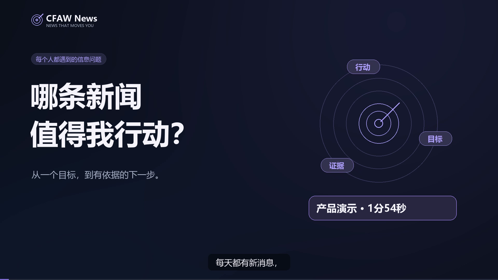](docs/videos/cfaw-news-demo.mp4)

**[播放 / 下载演示视频](docs/videos/cfaw-news-demo.mp4)** · **1 分 54 秒** · 1080p · 普通话配音与中文字幕。视频中的应用操作完整保留顶部栏和底部导航，配有轻柔音乐与流程动画；[独立字幕](docs/videos/cfaw-news-demo.zh-CN.srt)可一并下载。

视频围绕“每周只有两小时，想试一个能省时间的 AI 工具”展开：输入意图、核对理解、查看新闻依据、获得一次有限试用建议，再由用户批准导入应用内日程。70–93 秒加入最终版实拍截图；配音和字幕明确说明：**日期和时间已准备好，批准后直接保存，无需再次填写。** 模型等待和重复浏览已剪辑压缩，视频时长不代表实时推理耗时。下方另附[一键导入实拍](#从建议到日程一次批准即可保存)，可放大核对点击后的保存结果。

| 阅读真实新闻                                                                                     | 查看与自己有关的变化                                                                                      |
| ------------------------------------------------------------------------------------------ | ----------------------------------------------------------------------------------------------- |
| 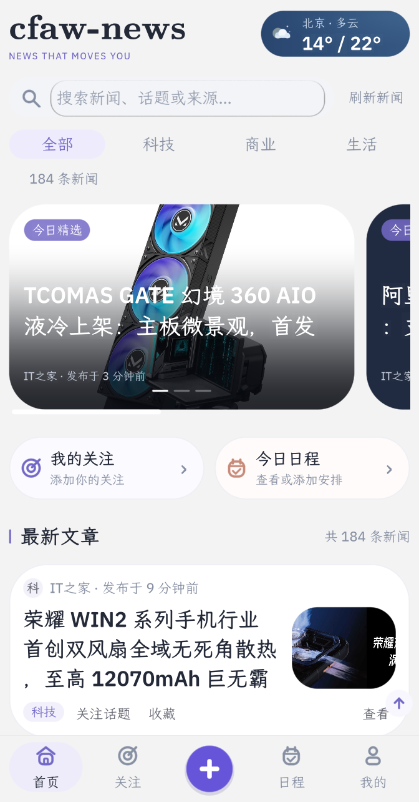 |  |

**内容导航：** [演示视频](#两分钟内看懂作品) · [核心案例](#三个日常决策案例) · [一键导入日程](#从建议到日程一次批准即可保存) · [证据与判断](#从建议回到证据) · [运行说明](#运行说明) · [完整截图图集](docs/gallery.md)

## 从信息流走向自己的目标

每天都有新工具、新产品和新规则，但“消息很多”并不等于“知道该做什么”。同一条 AI 新闻，对每周只有两小时的学习者、预算有限的换机用户和关注家人照片隐私的人，意义可能完全不同。

CFAW News 把**个人意图、新闻证据、判断历史、用户决定和应用内日程**连接起来：

1. **表达意图**：写下目标、使用场景和限制，Agent 整理成可以确认和修改的关注。
2. **检查变化**：从启用来源获取新闻，为每个话题寻找相关报道，判断它与目标的实际关系。
3. **解释依据**：展示目前情况、下一步建议、未知条件，以及实际引用的报道和原句。
4. **由用户决定**：记录观察、已处理或不采纳；明确希望安排试用时，查看任务与建议时段，批准后一键保存日程。
5. **继续跟踪**：结合上次判断与用户决定检查后续变化，必要时更新或撤回建议。

## 三个日常决策案例

这次决赛展示围绕**时间、金钱、信任**展开。三个案例使用同一套意图与证据流程，用户可以改成自己的真实需求。

| 关心的资源  | 用户表达的需求                                  | Agent 需要回答的问题                              |
| ------ | ---------------------------------------- | ------------------------------------------ |
| **时间** | 用 Mac 开会和做 PPT，每周只有两小时，想试一个能省时间的 AI 工具。  | 哪些能力与实际任务有关？是否支持我的设备、中文和现有账号？下一步怎样做一次有限试用？ |
| **金钱** | 想换约 6000 元的 AI 笔记本，主要写文档和开视频会议，旧电脑还能用。   | 新品是否提供足以影响换机决定的能力？价格、国行配置与兼容性有哪些待核实条件？     |
| **信任** | 我和家人在国内用 Google Photos 存照片，关心隐私、存储与收费变化。 | 报道是否直接涉及这个产品和我的使用条件？有没有需要处理的变化，还是继续观察即可？   |

### 时间：每周两小时，值得试什么？

输入具体任务和时间预算后，Agent 将需求整理为关注名称、范围、偏好与检索关键词。用户可以编辑理解，再确认保存，避免一个模糊需求直接变成持续关注。

| 说出目标与限制                                                                                                     | 核对理解                                                                                                   | 修改后再确认                                                                                    |
| ----------------------------------------------------------------------------------------------------------- | ------------------------------------------------------------------------------------------------------ | ----------------------------------------------------------------------------------------- |
| 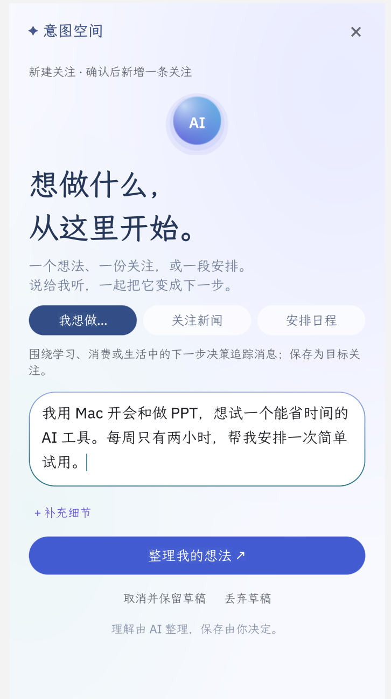 | 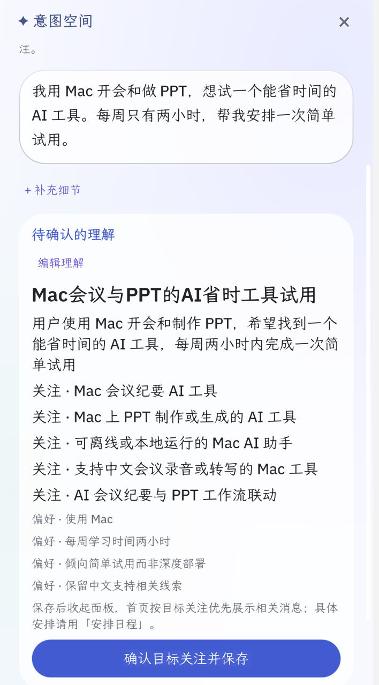 | 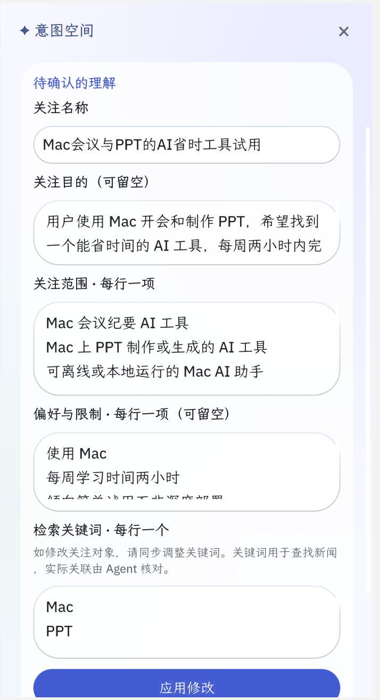 |

这轮实拍结果找到了与 Mac 会议、转写及幻灯片有关的报道，也明确保留了设备型号、账号套餐、中文效果和实际省时效果等未知项。建议是先核对条件，再选一个工具做单次试用。

“可能有关”之后，还有适用条件和实际验证。作品希望帮助用户把有限时间花在一个可核实的下一步上。

### 从建议到日程：一次批准即可保存

用户可以像日常聊天一样输入：

> 我用 Mac 开会和做 PPT，想试一个能省时间的 AI 工具。每周只有两小时，帮我安排一次简单试用。

确认关注后，在 **关注 → 检查更新 → 话题详情** 查看 **“简单试用计划”**。Agent 基于本目标的新闻依据提出任务、步骤和时长；应用检查已有日程，提供一个可以修改的建议时段。日期和起止时间已经出现在预览中。

**点击“确认并导入日程”后，日程直接成功保存，无需再输入日期、开始时间或结束时间。** 页面显示“已导入我的日程”，打开底部“日程”即可看到已保存的标题、内容和时间。只有想换个时段时，才需要使用“修改时间”。

| 点击前：任务与建议时段已经准备好 | 点击后：明确显示已导入 | 我的日程：已保存的试用安排 |
| --- | --- | --- |
| <a href="docs/images/final/trial-import-preview.png">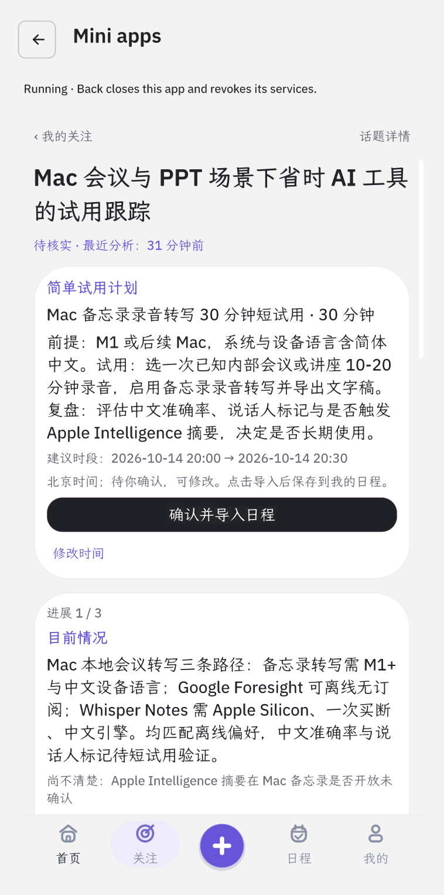</a> | <a href="docs/images/final/trial-import-saved.png">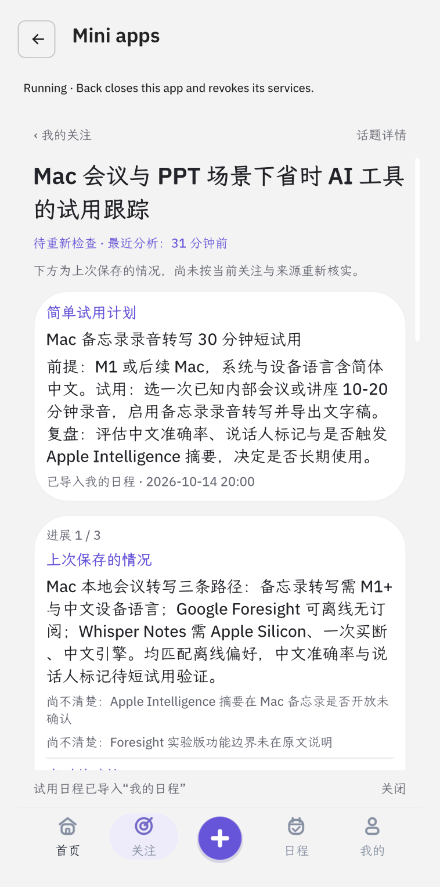</a> | <a href="docs/images/final/trial-import-calendar.png">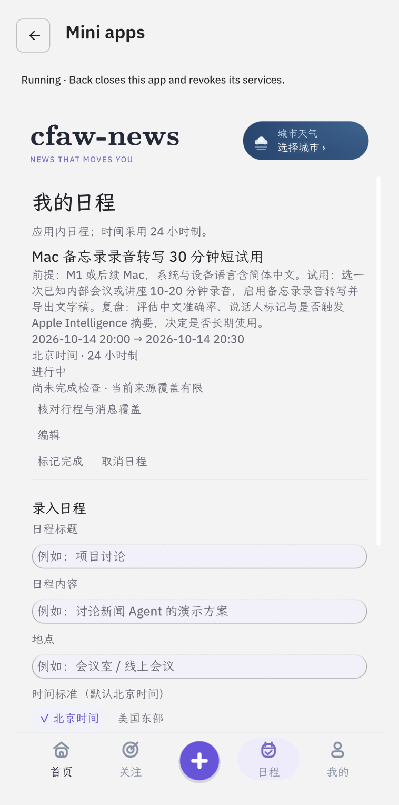</a> |

日程页下方的空白“录入日程”表单用于新建其他安排，不是继续导入的步骤。**列表中的试用日程已经保存，无需填写该表单。** 重复点击导入不会重复创建同一次试用；目标、证据或时间发生变化时，应用会重新校验。

这三张截图来自最终版 `bundle/` 的实际操作：在独立会话中完成一次真实 Agent 检查，只点击一次导入，然后核对持久化的日程记录。[操作核验记录](docs/evidence/trial-import.json)包含对应的包摘要、保存数量和时间信息。写入的是应用内日程。[30 项原生回归检查](docs/evidence/trial-import-regression.json)另外覆盖重复导入、时间冲突、证据失效和真实归档接入；回归使用合成测试数据，与实拍会话分开。

### 金钱与信任：保留约束，也允许继续观察

换机案例将预算、办公用途、旧设备仍可用、国行与中文支持纳入理解；照片案例保留家庭使用、国内访问、隐私、存储和收费等条件。

| 金钱：换机决策的约束                                                                                                              | 信任：家人照片的使用条件                                                                                                          |
| ----------------------------------------------------------------------------------------------------------------------- | --------------------------------------------------------------------------------------------------------------------- |
| 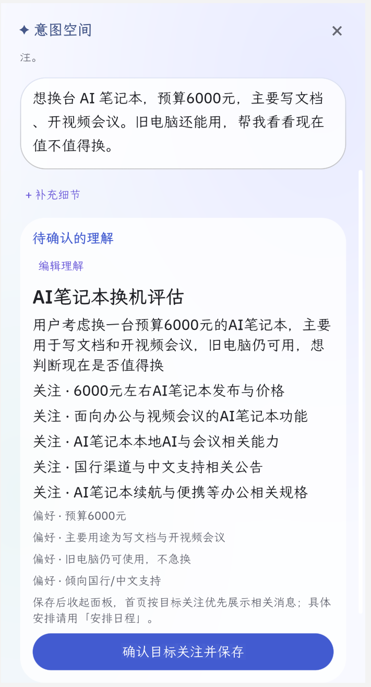 | 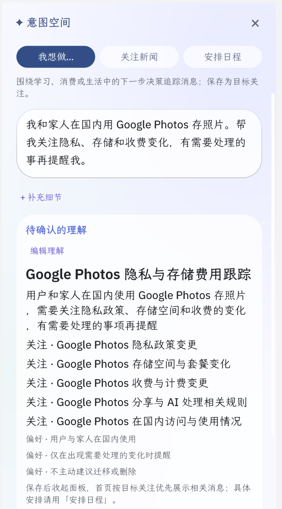 |

三案例关注页中，换机判断要求进一步核对国行报价与本地 AI 能力；照片关注显示本轮暂未发现需要立即处理的新依据。**一次完成的检查可以得出“继续观察”**。当前结论只对应本轮获取并分析的资料。

## 从建议回到证据

关注卡片按“**目前情况 → 建议下一步 → 查看依据**”呈现。进入判断依据页，可以核对：

- 为什么这条报道与当前目标有关；
- 当时使用的来源摘要和保存的正文片段；
- 对应的原文段落、原句与来源地址；
- 哪些适用条件尚未确认，哪些材料只提供了标题或摘要。

| 当前情况与下一步                                                                                           | 判断依据与未知条件                                                                                                 |
| -------------------------------------------------------------------------------------------------- | --------------------------------------------------------------------------------------------------------- |
| 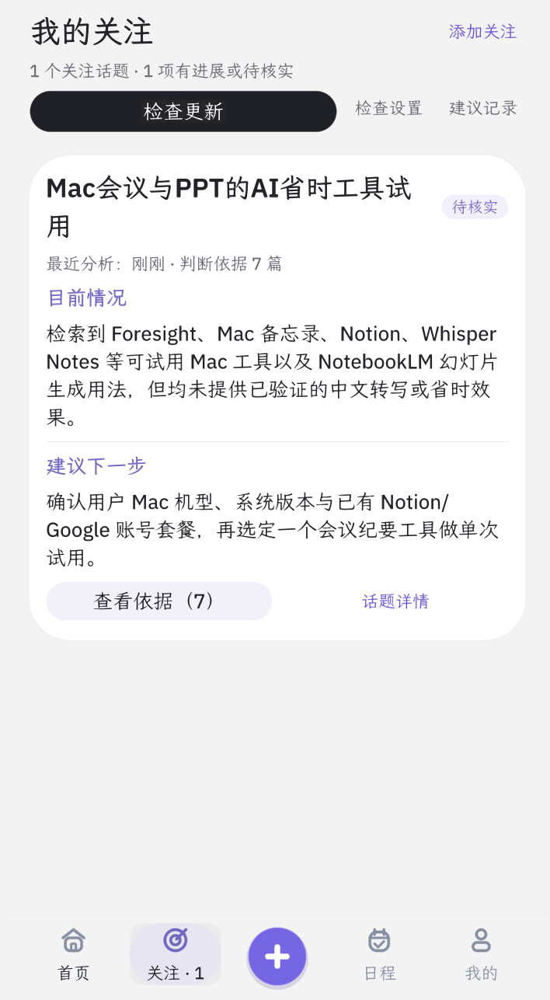 | 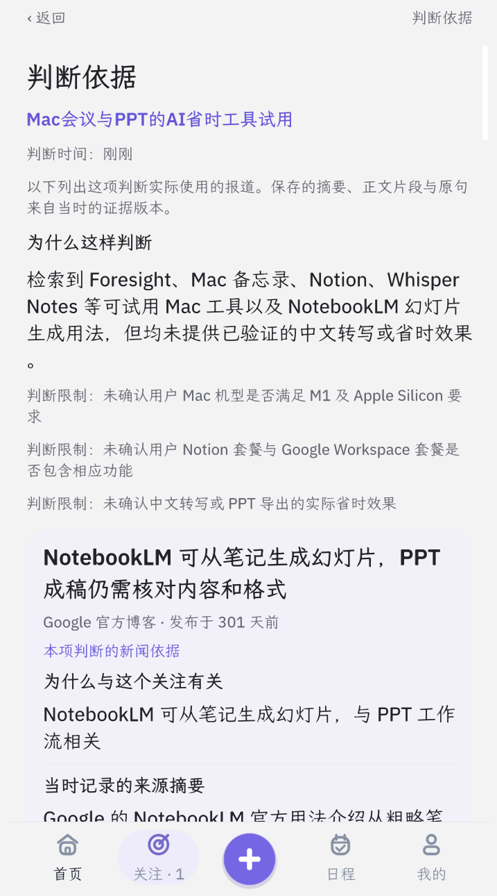 |

引用原句由应用从本轮保存的真实片段恢复，并校验新闻与段落标识。保存的证据快照可以在新闻流更新后继续回看；外文原句保留原语言，来源事实与 Agent 的解释分别展示。

完整证据链见 [决赛截图：判断依据](docs/gallery.md#判断依据与原文)。证据不足时显示待核实条件或“正文待补”，未确认相关新进展时保留上次情况。用户可以补充正文并重新判断，也可以记录继续观察、已处理或不采纳。

## 新闻阅读也是完整体验

首页支持**全部、科技、商业、生活**分类、关键词搜索、主动刷新、图片热点和收藏。新闻保留来源与原文入口，来源页可以启用、关闭来源并查看获取状态。

当前来源目录有 **28 个可选来源，10 个默认启用**：36氪、IT之家、少数派、MIT Research、Solidot、爱范儿、NASA 新闻发布、超能网、极客公园和 Popular Science。实际目录以 [sources.json](src/data/ingestion/sources.json) 为准。

最终呈现版另外保留 **26 条已核验的真实报道与官方资料归档**，覆盖三个演示案例，并与新闻源自动获取的内容共同参与检索。首页按来源发表时间排序；归档资料保留来源名称、原文地址、原句、适用条件和归档说明，不把归档加载时间当作发布时间。三个案例关注由用户在意图空间创建，Agent 根据对应资料分析。具体材料见 [真实资料归档](src/data/ingestion/demo_news.json)。

详情页分别展示来源摘要、可读取正文和配图。缺少来源摘要时，用户可以主动使用 **Agent 摘要提取**；完整正文读取成功后才生成全文摘要。需要核对网站原始页面时，通过 **打开图文原文** 进入应用内阅读。

| 阅读正文                                                                                     | 主动提取摘要                                                                                                | 在应用内查看原文                                                                            |
| ---------------------------------------------------------------------------------------- | ----------------------------------------------------------------------------------------------------- | ----------------------------------------------------------------------------------- |
| 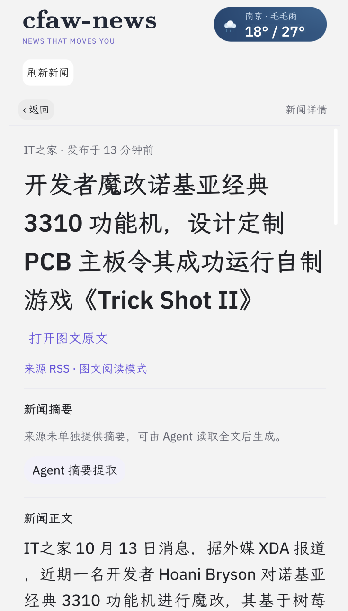 | 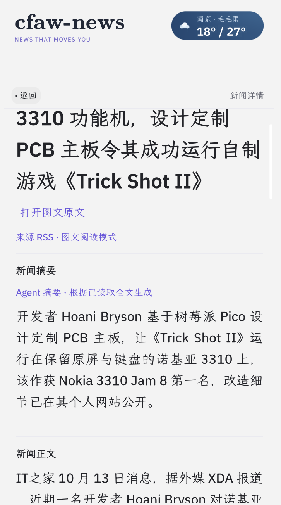 | 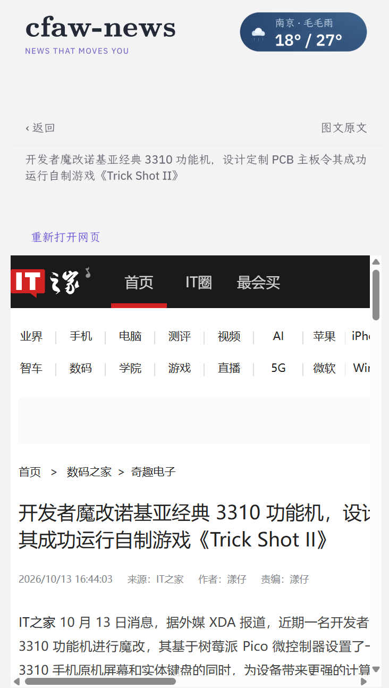 |

收藏独立保存新闻快照，支持搜索与分类。天气页可以选择城市，查看温度、降水和七日预报。应用内日程支持自然语言预览或表单录入，以及编辑、完成和取消；Agent 提议改期时仍需用户确认。

[查看分类、配图、收藏、天气与日程的全部界面](docs/gallery.md)

## 把天气带入日程判断

保存带有明确城市地点的日程后，应用会匹配该城市与日程日期的有效预报，交给同一个 Agent 与日程、候选新闻一起分析。即使这次没有相关新闻，也可以根据真实预报给出通勤与物品准备建议。

| 录入真实安排                                                                                | 查看天气准备建议                                                                                                      |
| ------------------------------------------------------------------------------------- | ------------------------------------------------------------------------------------------------------------- |
| 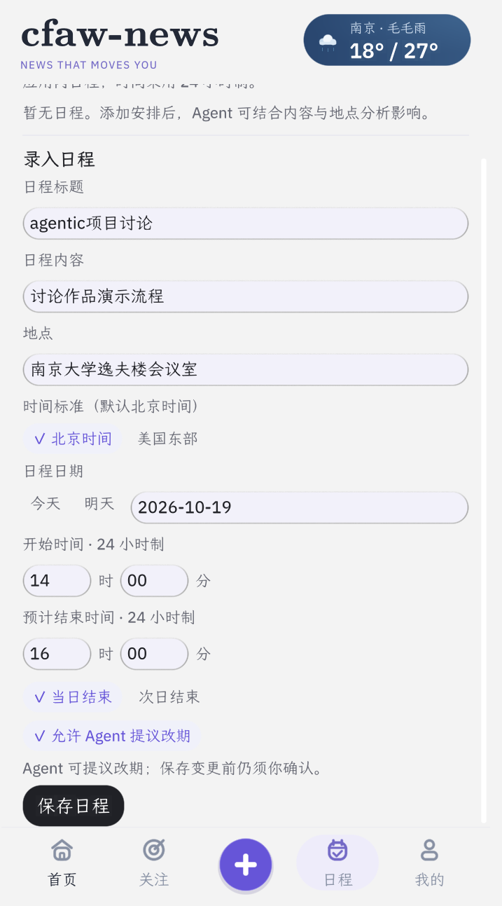 | 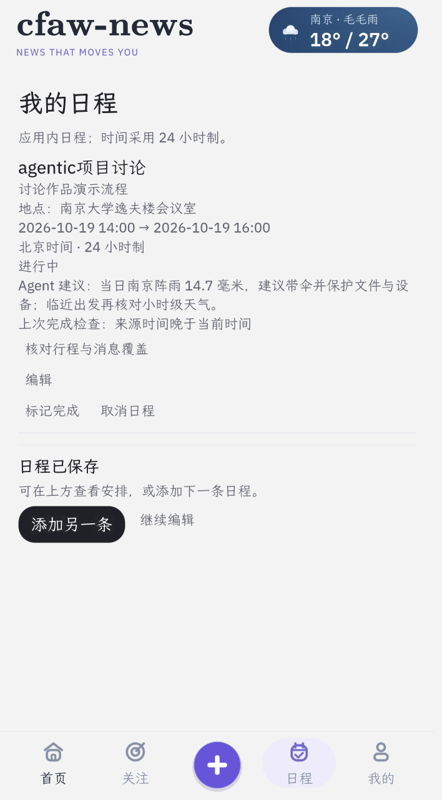 |

例如，室内会议当天的预报有降雨，Agent 可以提醒带伞、保护电脑和资料，并在临近出发时核对逐小时天气。判断使用日程所在地的预报，天气页切换到另一个城市不会替代日程地点。

每条建议须对应当前日程版本和预报标识。展开“核对行程与消息覆盖”可以查看预报日期、来源与获取时间；日程或预报变化后，旧建议失效。线上会议、地点含多个城市、过期预报或缺少对应日期时，不套用不匹配的天气。

日预报只支持准备和复核，不能据此断言会议时段必定下雨，也不会自行取消、改期或修改已经确认的日程。

## 作品如何实现

界面与业务使用 **OctoScript / Makepad**，通过 **Rinx 管理的 Octos** 调用应用 Agent。团队演示使用 MiniMax；模型与凭据由宿主管理。

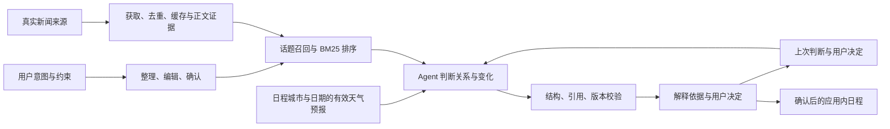

| 实现重点              | 对体验的作用                                     |
| ----------------- | ------------------------------------------ |
| **一个应用 Agent**    | 负责意图整理、新闻摘要与变化判断，检索、存储和校验由应用代码完成。          |
| **目标约束参与分析**      | 预算、设备、使用场景与时间限制影响建议，避免只有泛泛的行业总结。           |
| **标题筛选与 BM25 排序** | 支持中文二元词与英文词召回，逐话题准备候选和证据；当前没有向量索引。         |
| **有界执行与恢复**       | 每个话题最多分析 8 篇候选，正文补读最多 2 篇；支持进度、取消、限时与有限纠正。 |
| **结果与版本校验**       | 检查新闻引用、正文片段和当前目标版本，拒绝失效或不完整的输出。            |
| **试用计划与一键导入**    | Agent 提议一次有依据的有限试用，应用生成并检查建议时段；用户批准后直接保存，防止重复创建。 |
| **天气与日程联合分析**     | 将匹配城市和日期的预报作为独立证据，校验天气建议，保持已确认日程。          |
| **历史与用户决定**       | 对照前次判断，保留观察和不采纳等决定，支持解释建议变化与撤回。            |
| **用户确认**          | 关注保存、核实任务和日程变更由用户确认，模型输出不会自行修改安排。          |

新闻浏览、收藏、天气和手动日程管理可独立使用；需要推理的功能依赖宿主助手与模型服务。

## 运行说明

当前交付为 **Windows / Rinx 本地导入作品**。应用 ID 为 `dev.cfaw.news`，包版本为 `1.0.0`。

### 运行环境

| 条件                | 说明                                                                    |
| ----------------- | --------------------------------------------------------------------- |
| Windows 与兼容的 Rinx | 使用包含本项目正文阅读、WebReader 和新闻内存保护支持的宿主，并完成宿主要求的账号登录。                      |
| 配套 Octos 与宿主资源    | 宿主运行目录应包含 `octos.exe`、`makepad_widgets/resources` 和 `rinx/resources`。 |
| WebView2 Runtime  | 用于 Windows 应用内图文原文阅读。                                                 |
| 网络与模型服务           | 新闻、正文与天气需要访问对应来源；意图理解、摘要和联合分析还需要可用的宿主助手。                              |

应用交付包包含 `bundle/`，宿主需要另外准备。直接导入已有交付包无需安装 Python 或 Rust；从源码构建宿主和重新打包的方法见 [运行与构建说明](docs/development.md)。

### 启动宿主并导入应用

本机已准备完整新闻宿主时，在本项目根目录打开 PowerShell，执行：

```powershell
powershell -ExecutionPolicy Bypass -File scripts/start_news_host.ps1 -Visible
```

脚本默认使用项目根目录相对路径 `../../Rinx-main/target/release/rinx-news.exe`。宿主在其他位置时，通过 `-HostRoot` 指定 Rinx 仓库根目录：

```powershell
powershell -ExecutionPolicy Bypass -File scripts/start_news_host.ps1 -HostRoot 'D:\path\to\Rinx' -Visible
```

启动后按以下步骤导入：

1. 打开 **Mini apps → Import an app**。
2. 在 **OctoSense bundle folder** 中填写本项目 `bundle/` 的绝对路径。可用下面的命令获取路径；使用 [交付 ZIP](build/cfaw-news.zip) 时，先解压再选择其中的 `bundle/` 文件夹。
3. 核对应用名称 **CFAW News**、ID `dev.cfaw.news` 和申请的存储、联网、图片、网页及 Octos 会话权限。Room 可留空。
4. 按下一节配置助手，然后执行 **Review bundle → Run** 进入应用。

```powershell
(Resolve-Path '.\bundle').Path
```

### 配置助手并测试连接

在 Rinx 的助手配置中填写自己的模型信息。团队使用的配置如下，可用性以自己的账号和宿主配置为准：

| 配置项      | 值                           |
| -------- | --------------------------- |
| Provider | `minimax`                   |
| Model    | `MiniMax-M3`                |
| Base URL | `https://api.minimax.cn/v1` |
| API key  | 自己的 MiniMax 密钥，只在 Rinx 中填写  |

选择 **Use this device**，由 Rinx 管理本机 Octos；模型仍可通过云端 API 推理。当前锁定宿主重新保存助手配置时需重新填写密钥，空密钥再次保存可能覆盖已有配置，日常启动无需重复保存。

进入应用后，打开 **我的 → 新闻来源 → 连接诊断 → 测试连接**。收到实际助手回复后，再使用意图理解、摘要提取和联合分析。新闻浏览、收藏、天气和手动日程管理可独立使用。

### 初次使用与加载更新

- 在 **我的 → 新闻来源** 选择来源并查看获取状态，返回首页刷新新闻。
- 点击底部中央加号，输入自己的目标或安排，核对理解后确认保存。
- 在 **关注** 页检查更新并查看判断依据；带有明确城市地点的日程可匹配对应日期的天气预报。
- 明确请求安排试用后，在 **话题详情 → 简单试用计划** 核对建议时段，点击 **确认并导入日程** 即可保存；打开 **日程** 查看，无需再次录入日期或时间。
- 替换应用包或修改并重新打包源码后，退出旧应用，重新 **Review bundle → Run**。关注、收藏、日程等记录保存在宿主应用存储中，更新应用无需清空这些记录。

### 常见运行问题

| 现象                                          | 处理方式                                                                  |
| ------------------------------------------- | --------------------------------------------------------------------- |
| 找不到 `rinx-news.exe` 或宿主资源                   | 核对 `-HostRoot` 指向的目录，按 [构建说明](docs/development.md#准备宿主构建环境) 准备完整新闻宿主。 |
| `bundle digest does not match the manifest` | 使用完整交付包，或通过打包脚本刷新摘要，再重新 Review / Run。                                 |
| 助手未启用、模型鉴权或连接失败                             | 核对 Rinx 助手配置、密钥、模型 ID、Base URL 与连接诊断反馈。                               |
| 新闻、天气或正文读取失败                                | 在来源或天气页查看具体状态，核对网络；正文受限时通过应用内原文页阅读。                                   |

完整的宿主准备、源码组装、打包命令与故障处理见 [运行与构建说明](docs/development.md)。

## 体验范围与数据说明

- **跟踪在应用运行期间进行**，尚未提供关闭后的后台推送、跨设备同步或系统日历写入。
- **来源与正文存在访问条件**。登录、订阅、人机验证和网络问题可能限制读取；能在原文页看到内容，不等于 Agent 已获得该正文。
- **天气使用城市日预报**，依据日程的明确地点匹配城市；不读取设备定位，不提供会议时段的实况保证。
- **建议需要判断与核实**。引用和结构校验有助于追溯依据，不保证报道或模型解释一定正确。
- **模型推理可能经过云端**。相关输入、目标、日程和候选证据通过宿主发送给配置的模型；详见 [隐私说明](PRIVACY.md)。

本文与图集保留团队提供的 **2026 年 10 月 13 日决赛实拍截图**，并新增最终版“一键导入日程”的三张完整界面实拍。新闻、天气、价格和判断反映拍摄时状态。

## 交付内容与许可

```text
README.md                       作品介绍与运行说明
bundle/                         Rinx 导入入口、清单、图标与包内展示资源
build/cfaw-news.zip              本地导入交付包
src/                            OctoScript 业务源码与 Agent 提示词
native/windows-webreader/       Windows 应用内原文阅读支持
scripts/                        运行、构建、组装、打包及必要宿主适配
docs/development.md              运行与构建说明
docs/gallery.md                 决赛截图与一键导入实拍图集
docs/images/final/              30 张决赛原始截图与 3 张最终版导入截图
docs/images/demo-video-cover.png 演示视频封面
docs/videos/cfaw-news-demo.mp4   1 分 54 秒完整界面演示视频
docs/videos/cfaw-news-demo.zh-CN.srt 中文字幕
docs/evidence/trial-import.json 最终版一键导入操作核验记录
docs/evidence/demo-video.json   视频时长、格式与文件校验记录
dev-dependencies.lock.json      宿主与构建依赖锁定记录
LICENSE / NOTICE / LICENSES/    许可与第三方署名
PRIVACY.md                      数据与隐私说明
```

项目采用 [Apache License 2.0](LICENSE)。作品基于 OctoSense 新闻应用进行适配与扩展，使用 Rinx、Octos、OctoScript 与 Makepad 生态能力；来源目录参考 World Monitor，天气使用 Open-Meteo。上游与第三方归属见 [NOTICE](NOTICE)。新闻正文与图片归原发布者所有。
