# CFAW News 决赛截图图集

[返回作品介绍](../README.md)

图集包含团队提供的 30 张 2026 年 10 月 13 日决赛实拍，以及新增的 3 张最终版“一键导入日程”实拍。图片保留原始字节与比例，新增截图展示完整应用视口。新闻、天气、判断和日程反映拍摄时状态，实际体验以当前来源、宿主和用户记录为准。点击图片可查看原图。

[观看 1 分 54 秒演示视频](videos/cfaw-news-demo.mp4) · [查看一键导入实拍](#一次批准直接保存试用日程)

## 首页与新闻来源

| 首页：图片热点、最新文章与底部导航 | 科技板块 | 商业板块 |
| --- | --- | --- |
|  | <a href="images/final/home-technology.png">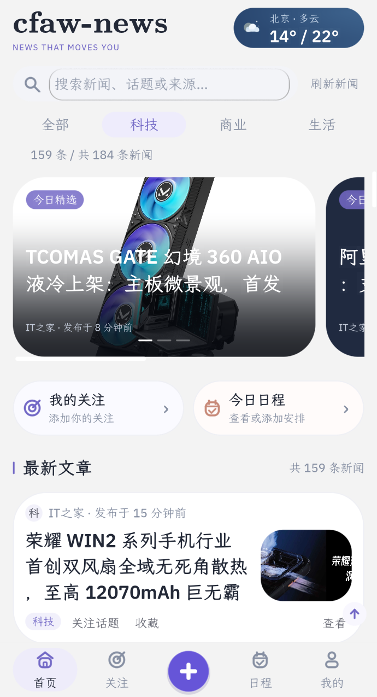</a> | <a href="images/final/home-business.png">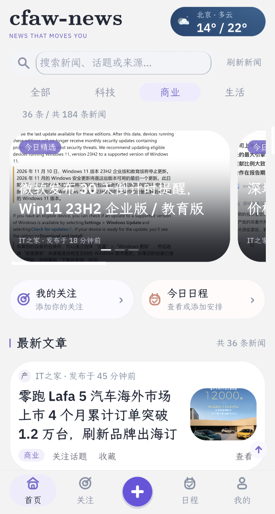</a> |

| 生活板块 | 新闻来源与获取状态 |
| --- | --- |
| <a href="images/final/home-life.png">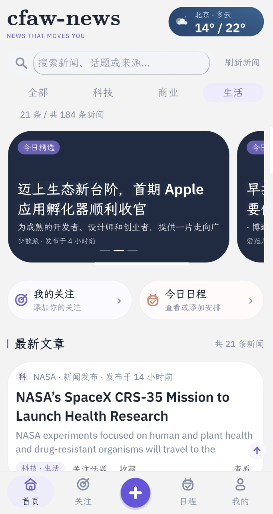</a> | <a href="images/final/news-sources.png">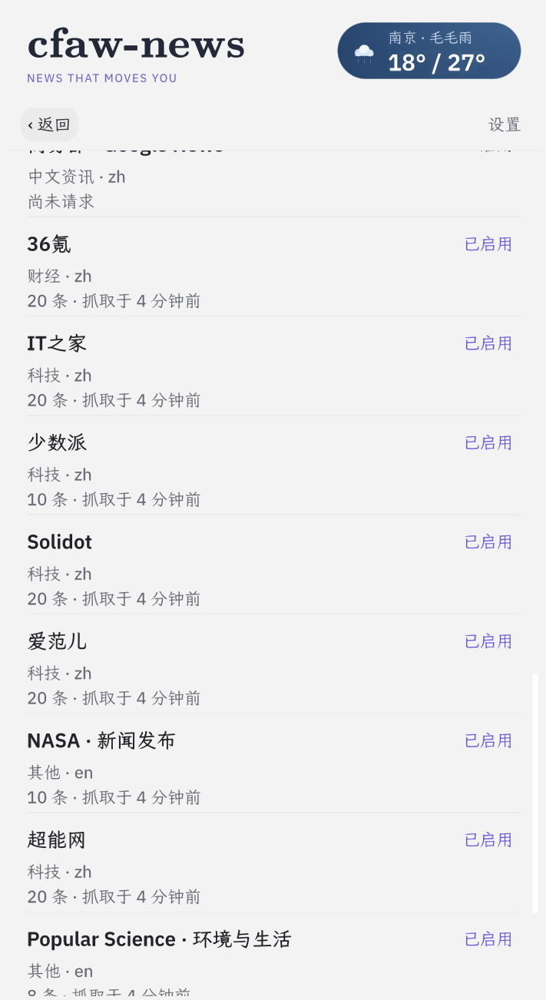</a> |

## 表达意图与用户确认

| 底部加号进入意图空间 | 时间案例：表达 Mac 会议与 PPT 的省时目标 | 时间案例：理解预览 |
| --- | --- | --- |
| <a href="images/final/intent-space.png">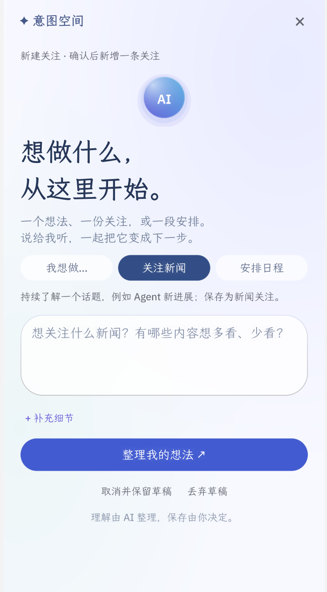</a> |  |  |

| 二次编辑理解、范围与检索关键词 | 金钱案例：表达预算与换机需求 | 金钱案例：保留预算、用途与旧设备条件 |
| --- | --- | --- |
|  | <a href="images/final/intent-money-input.png">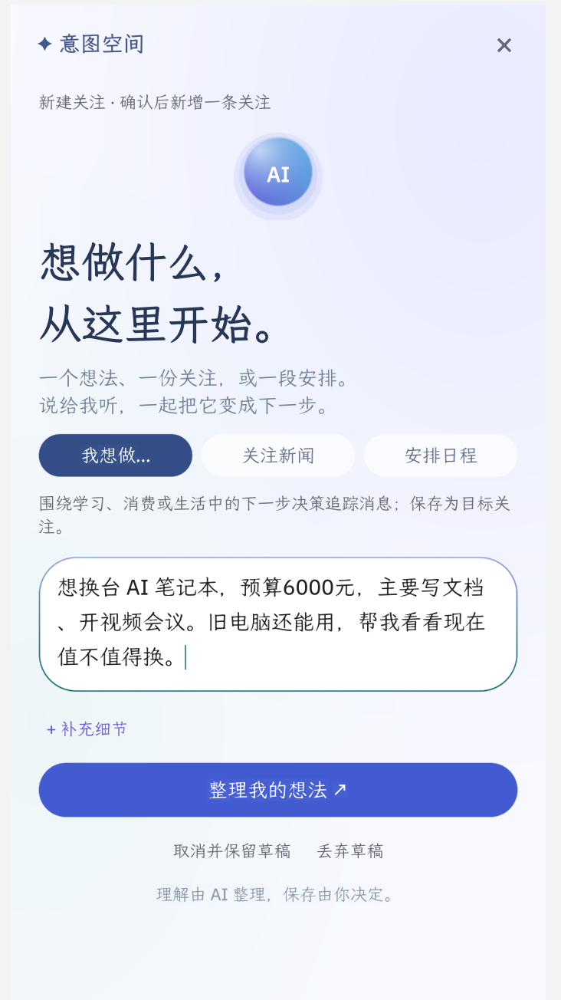</a> |  |

| 信任案例：Google Photos 隐私与存储关注 |
| --- |
|  |

## 关注结果

| 时间、金钱、信任三个关注的结果入口 | 时间案例：目前情况、未知条件与下一步 |
| --- | --- |
|  |  |

## 判断依据与原文

| 解释关联理由与判断限制 | 保存的来源摘要与 NotebookLM 原句 | Foresight 的来源信息与原句 |
| --- | --- | --- |
|  | <a href="images/final/time-evidence-notebooklm.png">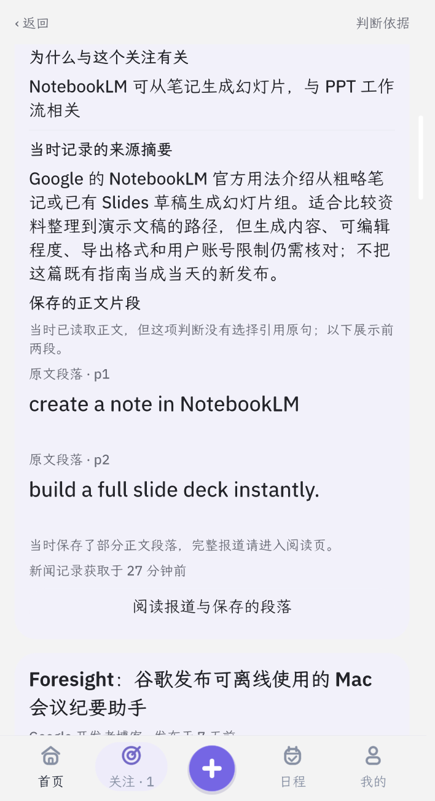</a> | <a href="images/final/time-evidence-foresight.png">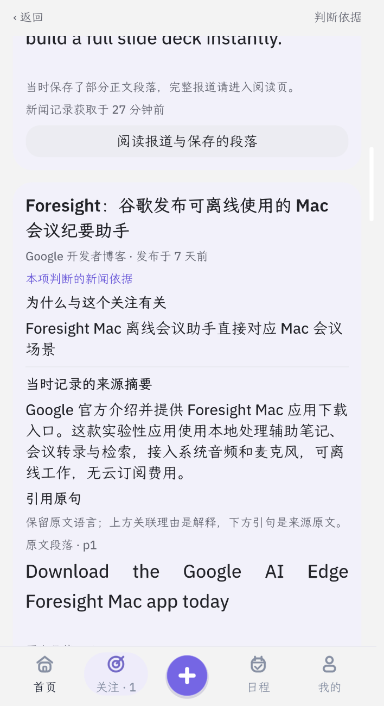</a> |

| Whisper Notes 的适用设备条件 | 从判断依据打开保存的证据与原文地址 |
| --- | --- |
| <a href="images/final/time-evidence-whisper.png">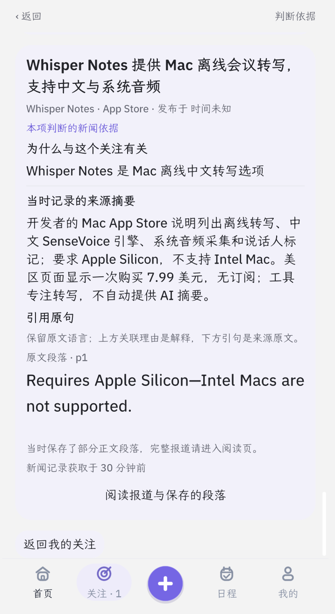</a> | <a href="images/final/evidence-original.png">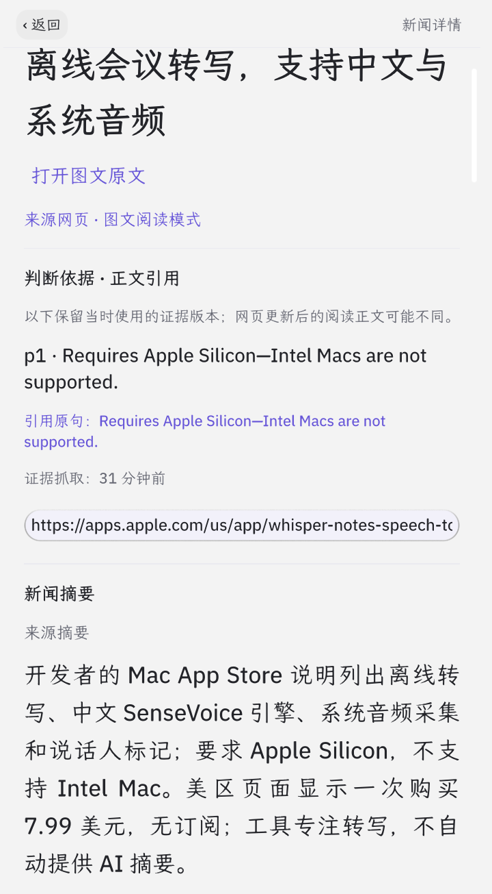</a> |

## 正文阅读与收藏

| 新闻详情：摘要入口与正文 | 正文配图、原文地址与收藏入口 | 用户主动请求的 Agent 摘要 |
| --- | --- | --- |
|  | <a href="images/final/news-reader-images.png">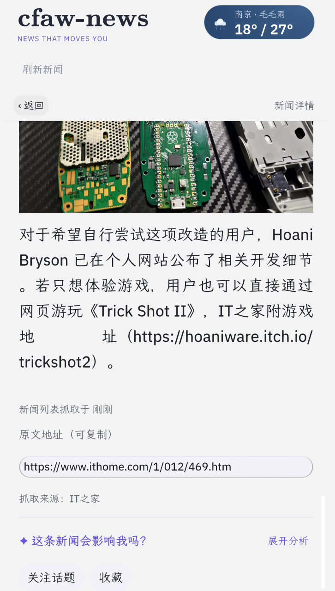</a> |  |

| 应用内原文页 | 独立收藏列表、分类与搜索 |
| --- | --- |
|  | <a href="images/final/bookmarks.png">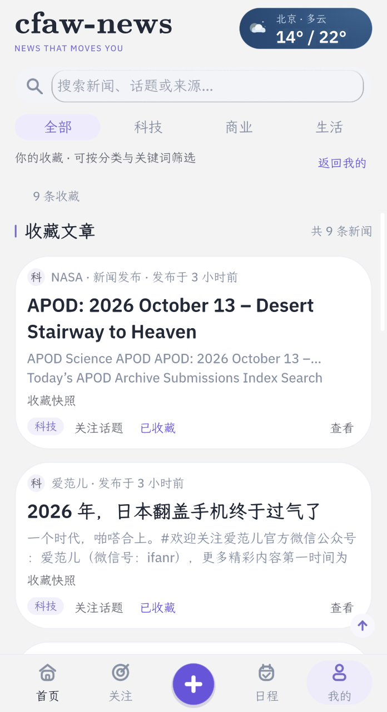</a> |

## 天气与日程

### 一次批准，直接保存试用日程

在意图中明确希望安排一次试用后，查看 **话题详情 → 简单试用计划**。任务、时长、日期与起止时间已准备好；点击 **“确认并导入日程”** 直接保存，不需要再输入日期或时间。

| 点击前：建议任务与时段 | 点击后：已导入我的日程 | 打开日程：已保存安排 |
| --- | --- | --- |
|  |  |  |

日程页中另建安排的空白表单不属于导入流程；列表中的试用安排已经保存。这三张截图录自最终版实际运行的 `bundle/`，使用新完成的真实 Agent 检查，核验只创建一条日程。[查看操作核验记录](evidence/trial-import.json)。

### 天气与其他日程

| 城市天气与七日预报 | 选择城市 | 切换后的南京预报 |
| --- | --- | --- |
| <a href="images/final/weather.png">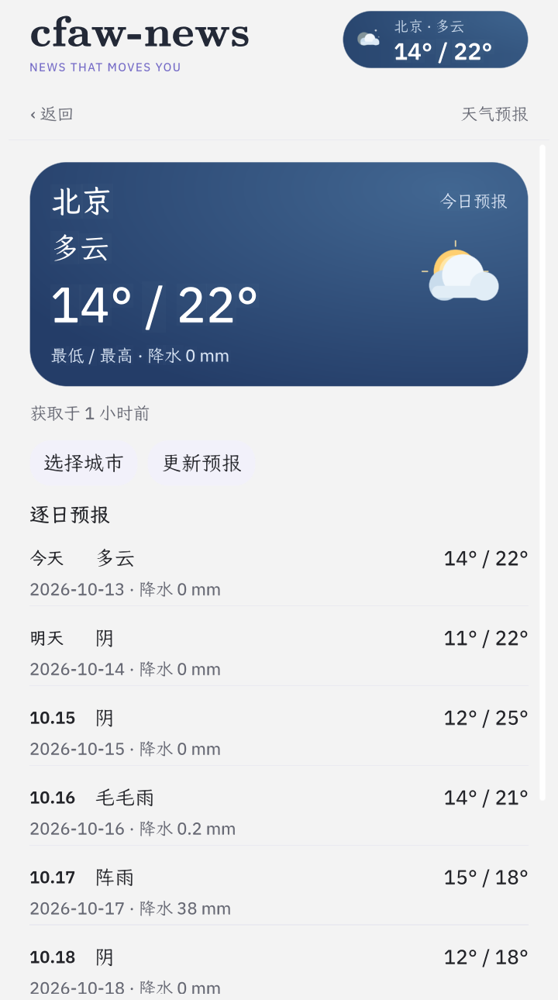</a> | <a href="images/final/weather-city-picker.png">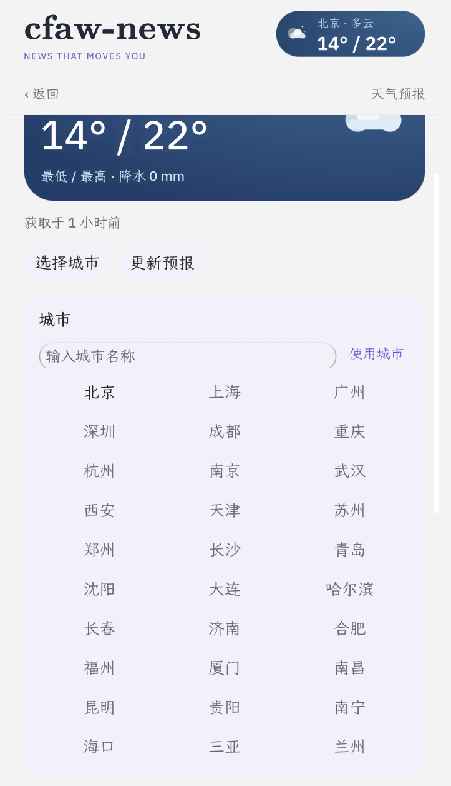</a> | <a href="images/final/weather-nanjing.png">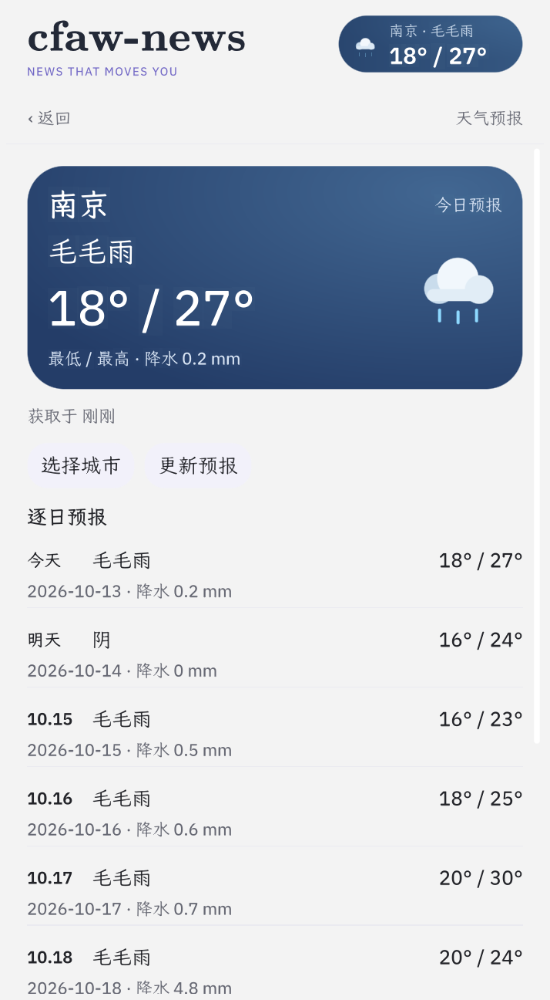</a> |

| 日程入口与录入表单 | 日程标题、内容、地点、日期与起止时间 | 已保存日程与 Agent 天气准备建议 |
| --- | --- | --- |
| <a href="images/final/schedule-empty.png">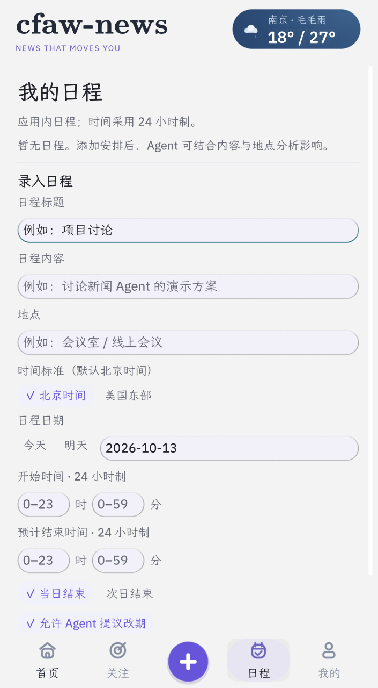</a> |  |  |

