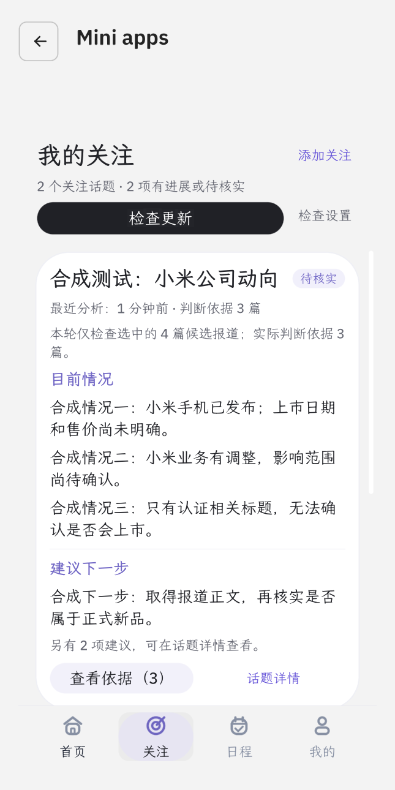
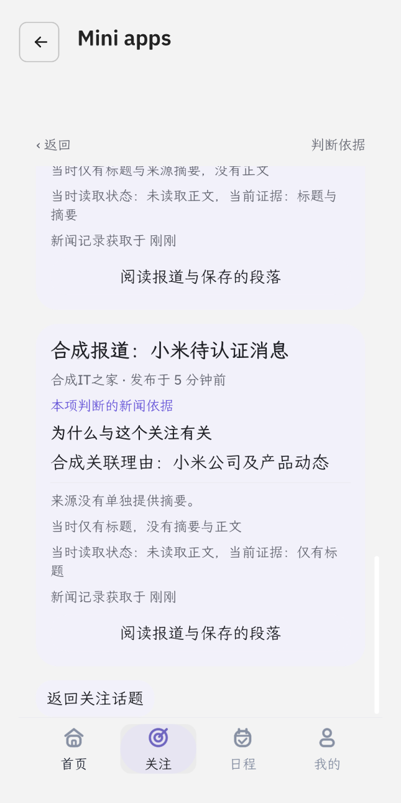

# 关注页面重做验证（2026-10-12）

交付目录：`workspace/cfaw-news-agent-10.11`。用户确认的设计见 [关注页面设计与实现](../docs/follow-page-design-20261011.md)。安装包与完整性结果见本文末尾及 `../build/follow-topic-ui-verification.json`；先前引文修复报告中的 digest 属于旧包。

后续启动恢复修复已经更新安装包，最新包以 [启动恢复验证](startup-topics-20261012.md) 为准；本文208项检查与digest记录属于关注页面重做完成时。

## 用户可见的变化

关注入口先显示用户确认保存的话题。每张卡按目前情况、建议下一步、查看依据排列；情况来自该话题最多3项已经校验的独立事件判断，不额外生成未经校验的全话题结论。有进展或待核实者优先，暂停话题折叠。关注页不再显示首页天气、搜索、今日精选和最新文章，悬浮球不遮挡话题操作。

话题详情保留每项事件的完整情况、变化、未知条件和原建议；继续观察不会覆盖具体建议，已处理和不采纳不再作为新增安排。修改、暂停、恢复、取消和单独检查集中在该话题下。历史、暂停及已失效判断只供回顾，原 owner 仍严格核对版本、目标及证据后才允许操作。

判断依据是独立页面，只列本话题实际引用且通过目标关联检查的报道。来源摘要、已读正文片段、选用原句和仅有标题分别标注；中文解释与外文原句分开。快照阅读不依赖报道仍在首页，返回保留话题与入口。普通首页阅读清理上一次快照上下文。

检查更新逐个处理所有有效话题，每话题各自选取最多8篇候选并完成保存后继续；暂停项跳过，一项失败继续其他项。停止、上下文变化、待保存结果或未确认宿主中断结束后续排队。无候选不能当作没有新消息，失败和检查中保留上次情况并注明时间。历史仍限12轮；已完成检查但详情未保留时，显示成功检查时间与单独重查入口，不伪造分析结果。

## 实际验证范围

以下均运行于隔离的原生测试应用，使用明确标记的合成话题和报道，不读写真实用户账号记录，不调用真实模型或新闻网站。

- `scripts/test_follow_topic_ui.py`：28项交互断言及无原生错误检查通过（终端总数29）。实际视口430×860；验证总览顺序、三种证据形态、来源离开首页后的阅读及返回、跨话题隔离、失效决定拦截、单独检查、暂停恢复、编辑与关闭保留草稿、底部导航以及首页布局和普通阅读上下文。
- `scripts/test_tracking_evidence_flow.py`：43项证据、判断、保存和原生交互回归通过，无原生错误。3次模拟模型回复（含一次有界修正）、4次模拟文章读取。
- `scripts/test_follow_topic_queue.py`：136项逐话题排队与历史记录边界检查通过，无原生错误。包含忙碌间隙、自动检查互斥、停止后迟到回调、目标变化、保存失败、暂停项排除，以及成功水位不能冒充已淘汰的分析详情。
- 先前完成的引文修复48项原生检查记录仍见 [引文验证报告](tracking-quote-choices-20261011.md)。此次保留其原文片段恢复和严格校验实现，未将先前48项计为本次新增检查。

新证据页曾因固定宿主的分支末尾循环缺少明确分支值而发生空栈错误；目前预先整理展示字段，并在相关分支提供明确值。完整交互与证据回归均无脚本错误。复现边界见 `../docs/splash-runtime-notes.md`。

本次未复测真实模型的语义判断质量、真实新闻覆盖率、站点验证或完整Rinx配置下的服务交互；原生模拟交互通过不能替代这些验证。包完整性检查也不表示App Hub收录或发布。

## 原生截图

截图中所有话题、报道和建议均为合成测试数据，用于核对界面和操作，不是新闻更新成功的证据。

| 关注总览 | 新闻依据 |
| --- | --- |
|  |  |

## 安装与完整性

退出旧实例，重新 Review/Run 当前目录的 `bundle`。应用ID及用户记录格式沿用，原关注、日程与决定不清空；旧判断注明历史状态，需要检查后才能产生当前判断。

本次组装及 `assemble.py --check` 通过，兼容Hub的unsigned本地检查通过。ZIP共8项，CRC及与当前bundle、LICENSE、NOTICE逐字节一致性通过。Bundle digest为 `a71538fc396d3a13cd8b14c51b5b0aa413f37510ae4deb510585f6f2531550cd`。

最终聚合结果记录于 `../build/follow-topic-ui-verification.json`，本次共208项检查通过。ZIP为 `../build/cfaw-news.zip`。使用的是本地开发包，未推送、发布或上传外部服务。
